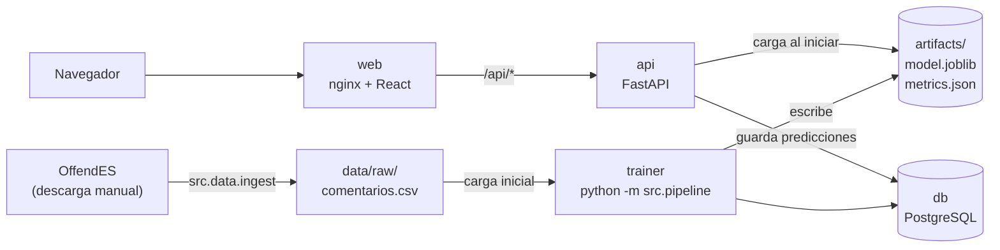

# Ofensómetro (backend)

API en Python que detecta **lenguaje ofensivo** en comentarios de redes sociales en español.
Proyecto integrador de Tópicos de Programación Avanzada. Contiene las capas de **datos, NLP,
modelos, backend y una aplicación web** que consume la API.

Para cada comentario la API devuelve:

- una de cuatro clases (corpus OffendES): `NO`, `NOE` (groserías sin ofender), `OFP` (ofensa a una
  persona), `OFG` (ofensa a un grupo);
- un veredicto binario **ofensivo / no ofensivo**, con su probabilidad;
- las palabras que más pesaron en la decisión;
- cada paso del preprocesamiento.

## Arquitectura



## Levantar el sistema

### Con Docker (recomendado)

Requisitos: Docker con Compose v2 y ~3 GB libres.
En las secciones 'password' de docker-compose ingresa tu contraseña de PostgesSQL

```bash
docker compose up --build
```

- Aplicación web: http://localhost:8080
- Documentación de la API: http://localhost:8000/api/docs

La API tarda unos segundos en arrancar (carga spaCy); la web espera a que esté lista.

### Sin Docker

```bash
python -m venv .venv && source .venv/bin/activate      # Windows: .venv\Scripts\activate
pip install -r requirements-dev.txt
python -m src.pipeline --synthetic                     # entrena (demostración)
uvicorn api.main:app --reload                          # http://localhost:8000/api/docs
```

## Usando los datos reales (OffendES)

1. Descarga los archivos (acceso condicionado) siguiendo [data/README.md](data/README.md) y
   colócalos en `data/external/offendes/`.
2. `python -m src.data.ingest` genera `data/raw/comentarios.csv`.
3. `python -m src.pipeline` entrena (o `make train` con Docker). Reinicia la API.

`GET /api/health` debe mostrar `"datos": "offendes"` y `"modo_demo": false`.

> `docker compose up` **no reentrena** si ya existe `artifacts/model.joblib` (es intencional). Tras
> conseguir los datos reales usa `make train`, o borra `artifacts/` y vuelve a levantar.

## Uso diario

| Tarea | Comando | Atajo |
|---|---|---|
| Levantar todo en segundo plano | `docker compose up --build -d` | `make up` |
| Convertir OffendES al formato del proyecto | `docker compose run --rm trainer python -m src.data.ingest` | `make ingest` |
| Reentrenar con datos reales y reiniciar la API | `docker compose run --rm trainer python -m src.pipeline --reload-data` + `docker compose restart api` | `make train` |
| Pruebas automáticas | `docker compose --profile dev run --rm --build tests` | `make test` |
| Reconstruir la web tras cambiar `frontend/` | `docker compose up -d --build web` | `make web` |
| Ver la base en el navegador | `docker compose --profile tools up -d adminer` → http://localhost:8081 | |

Puertos ocupados: copia `.env.example` a `.env` y cambia `API_PORT` / `DB_PORT`.

## Cómo viaja una predicción

1. El cliente hace `POST /api/predict` con `{"texto": "..."}`.
2. FastAPI valida el cuerpo (`api/schemas.py`): vacío, demasiado largo o sin letras → 422 en español.
3. `ModelService.classify()` llama a `pipeline.predict_proba()`. El pipeline guardado ejecuta:
   `TextPreprocessor` → `TfidfVectorizer` → modelo (regresión logística o Naive Bayes
   complementario, el que ganó en validación cruzada).
4. Con las cuatro probabilidades se calcula `P(ofensivo) = P(OFP) + P(OFG)` y se compara con el umbral.
5. `explain_terms()` calcula qué términos empujaron el resultado (valor TF-IDF x peso del modelo).
6. La predicción se guarda en PostgreSQL; si la base falla, igual se responde.

El backend **no reimplementa** el preprocesamiento: lo ejecuta el primer paso del pipeline que se
guardó al entrenar.

## Estructura

```text
ofensometro/
├── data/
│   ├── external/offendes/        # aquí van los archivos descargados (no se suben a git)
│   ├── raw/                      # comentarios.csv (real)
│   └── README.md                 # origen, licencia, clases y diccionario de datos
├── db/init.sql                   # esquema de PostgreSQL
├── src/
│   ├── config.py                 # rutas (Locations) y lectura de params.yaml
│   ├── db.py                     # Repository: tablas y consultas con SQLAlchemy Core
│   ├── pipeline.py               # un comando: datos -> BD -> entrenamiento
│   ├── data/
│   │   ├── ingest.py             # OffendES -> comentarios.csv
│   │   └── prepare.py            # limpieza, EDA y división
│   ├── nlp/
│   │   ├── lexicon.py            # jerga, emojis y sustituciones (datos, no lógica)
│   │   ├── normalizer.py         # limpieza del texto y detección de señales
│   │   └── preprocessing.py      # TextPreprocessor: stop words, raíz/lema, TF-IDF-ready
│   └── models/
│       ├── experiments.py        # modelos, búsqueda en dos etapas, pipeline de producción
│       ├── evaluate.py           # métricas (4 clases y binaria), errores, fenómenos
│       ├── explain.py            # términos que pesaron en UNA predicción
│       ├── report.py             # arma metrics.json
│       ├── artifacts.py          # escribe model.joblib, metrics.json, CSV
│       └── train.py              # orquesta: dividir, buscar, entrenar, probar, guardar
├── api/
│   ├── main.py                   # punto de entrada (uvicorn api.main:app)
│   ├── app.py                    # fábrica de la aplicación y CORS
│   ├── deps.py                   # dependencias: modelo cargado, base configurada
│   ├── errors.py                 # ApiError y formato único de error
│   ├── batch.py                  # lectura y validación de archivos .txt/.csv
│   ├── explanations.py           # de raíces del modelo a palabras del usuario
│   ├── schemas.py                # contratos de entrada y salida
│   ├── service.py                # carga del modelo y clasificación
│   └── routes/                   # status, predict, insights
├── tests/                        # NLP, datos, entrenamiento y API (65 pruebas)
├── docs/api.md                   # endpoints, ejemplos y cómo conectar la web
├── params.yaml                   # todos los parámetros del experimento
├── Dockerfile · docker-compose.yml · Makefile · .env.example
└── requirements.txt              # versiones exactas
```

## Atribución

La arquitectura en capas (datos, NLP, modelos, API, base de datos, frontend en React y Docker) 
sigue la del proyecto de referencia del curso, <https://github.com/kenjikv/opiniometro>.
La implementación, el preprocesamiento para lenguaje ofensivo, la vista binaria, la explicación 
por término, la búsqueda en dos etapas y la interfaz (hoja anotada, medidor, pantallas) son 
propios de este proyecto.

## Documentación

- [API](docs/api.md): endpoints, ejemplos con `curl`, errores y cómo se conecta la web.
- [Datos](data/README.md): OffendES, cómo descargarlo, licencia y diccionario.

## Problemas habituales

| Situación | Qué hacer |
|---|---|
| `No encuentro los datos reales` | Falta `data/raw/comentarios.csv`: ver «Usando los datos reales». |
| `faltan las columnas [...]` al ingerir | Tus archivos traen otros nombres: ajusta `params.yaml → data.source.columns`. |
| `/api/health` dice `modo_demo: true` | El modelo se entrenó con datos sintéticos. Entrena con OffendES. |
| Cambié `params.yaml` y la API muestra lo mismo | El modelo se carga al iniciar: reentrena y reinicia la API. |
| `port is already allocated` | Cambia el puerto en `.env`. |