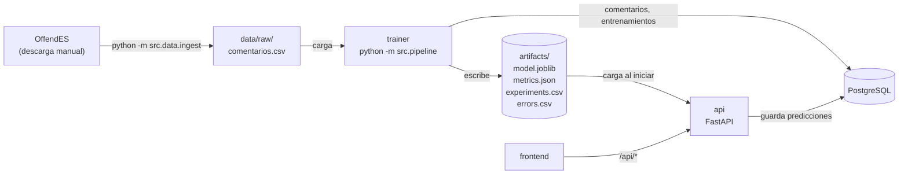
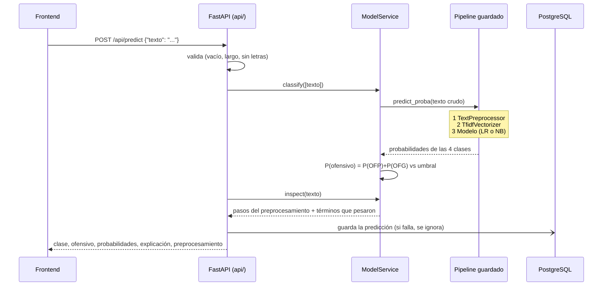
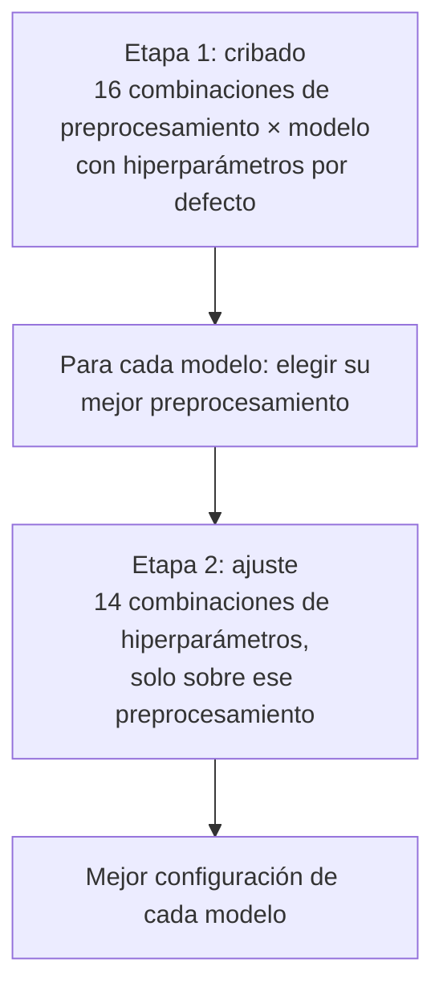

# Ofensómetro: documentación del backend

Documentación técnica del backend del proyecto integrador de **Tópicos de Programación Avanzada**.
Describe qué hace el sistema, cómo está construido, por qué se tomó cada decisión y cómo
ejecutarlo desde cero.

> **Cómo usar este documento.** Los ejemplos de preprocesamiento (secciones 4.1 a 4.7) son la
> salida real del código del proyecto. Los **resultados numéricos** del entrenamiento dependen de los
> datos con que se entrene, así que en la sección 6 aparecen marcados como `[completar]`: se llenan
> con los valores de `artifacts/metrics.json` o de la pantalla **Modelo** de la aplicación, una vez
> entrenado con OffendES.

## Contenido

1. [Resumen](#1-resumen)
2. [Arquitectura](#2-arquitectura)
3. [Datos](#3-datos)
4. [Pipeline de NLP](#4-pipeline-de-nlp)
5. [Modelos de machine learning](#5-modelos-de-machine-learning)
6. [Evaluación y análisis de errores](#6-evaluación-y-análisis-de-errores)
7. [Pipeline reproducible](#7-pipeline-reproducible)
8. [API REST](#8-api-rest)
9. [Pruebas automáticas](#9-pruebas-automáticas)
10. [Instalación y ejecución desde cero](#10-instalación-y-ejecución-desde-cero)
11. [Decisiones de diseño y limitaciones](#11-decisiones-de-diseño-y-limitaciones)
12. [Guía de defensa](#12-guía-de-defensa)
13. [Glosario y referencias](#13-glosario-y-referencias)

---

## 1. Resumen

### 1.1 El problema

Las plataformas sociales reciben miles de comentarios por minuto y revisarlos a mano no escala. El
**Ofensómetro** recibe un comentario en español y responde:

- **a qué clase pertenece** de cuatro posibles (corpus OffendES);
- **si es ofensivo o no** (vista binaria), con su probabilidad;
- **qué palabras pesaron** en la decisión, para que la persona pueda entender y discutir el resultado;
- **cómo se procesó el texto**, paso a paso.

| Clase | Nombre | Significado | ¿Ofensiva? |
|---|---|---|---|
| `NO` | No ofensivo | Sin ofensas ni palabras fuertes | No |
| `NOE` | No ofensivo con groserías | Usa palabras fuertes **sin** intención de ofender (suele ser positivo) | No |
| `OFP` | Ofensivo a una persona | Ofensa dirigida a un individuo concreto | **Sí** |
| `OFG` | Ofensivo a un grupo | Ofensa dirigida a un colectivo (etnia, género, ideología, religión...) | **Sí** |

La tarea de machine learning es **clasificación multiclase**. La vista binaria se **deriva** de las
cuatro clases: `P(ofensivo) = P(OFP) + P(OFG)`, y el comentario es ofensivo si supera un umbral
(0,5 por defecto, configurable en `params.yaml`).

### 1.2 Por qué este tema

Es un problema de texto real, en español, con una dificultad interesante que obliga a tomar
decisiones de NLP justificadas: en este dominio **lo que normalmente se borra como "ruido" es la
señal**. Las groserías, la negación, los emojis, las mayúsculas y la escritura disfrazada
(`1di0ta`) cambian el significado. Además, el corpus está muy desbalanceado (la clase `OFG` es
cerca del 1 %), lo que obliga a elegir métricas y modelos con criterio.

### 1.3 Cumplimiento de la guía del proyecto

| Requisito de la guía | Dónde se cumple |
|---|---|
| **4.1** Análisis exploratorio | `src/data/prepare.py` (`describe`), pantalla **Datos**, sección [3.5](#35-análisis-exploratorio) |
| **4.1** División estratificada con semilla fija | `prepare.split`, sección [3.6](#36-división-entrenamiento--prueba) |
| **4.1** Tratamiento del desbalance | Sección [3.7](#37-desbalance-de-clases) |
| **4.2** Normalización, tokenización, stop words, stemming y lematización, n-gramas, TF-IDF | `src/nlp/`, sección [4](#4-pipeline-de-nlp), con ejemplos antes/después |
| **4.3** Uno o dos modelos, línea base, validación cruzada, análisis de errores | `src/models/`, secciones [5](#5-modelos-de-machine-learning) y [6](#6-evaluación-y-análisis-de-errores) |
| **4.4** Pipeline reproducible de un solo comando | `python -m src.pipeline`, sección [7](#7-pipeline-reproducible) |
| **4.5** API con predicción, métricas, estado, validación, documentación y pruebas | `api/`, secciones [8](#8-api-rest) y [9](#9-pruebas-automáticas) |
| **4.6** Frontend que consume la API | Proyecto `frontend/`, ver `documentacion-frontend.md` |
| **4.7** README e instrucciones desde cero; contenedores como valor agregado | Sección [10](#10-instalación-y-ejecución-desde-cero), `Dockerfile` y `docker-compose.yml` |

### 1.4 Tecnologías

| Componente | Tecnología | Versión |
|---|---|---|
| Lenguaje | Python | 3.12 |
| Machine learning | scikit-learn | 1.9.1 |
| NLP | spaCy (`es_core_news_sm` 3.8.0), NLTK (SnowballStemmer), emoji | 3.8.16 / 3.10.4 / 2.16.0 |
| Datos | pandas, NumPy | 3.1.0 / 2.5.4 |
| API | FastAPI + Uvicorn | 0.161.0 / 0.54.0 |
| Base de datos | PostgreSQL 16 con SQLAlchemy 2 y psycopg 3 | 2.1.6 / 3.3.6 |
| Serialización | joblib | 1.6.0 |
| Pruebas | pytest | 9.1.1 |
| Contenedores | Docker y Docker Compose | opcional |

Todas las versiones están fijadas en `requirements.txt` (sección [7](#7-pipeline-reproducible)).

---

## 2. Arquitectura

### 2.1 Vista general



El sistema tiene las **cinco capas obligatorias**: datos, pipeline de NLP, modelos, backend y
frontend. El backend (este documento) cubre las cuatro primeras.

### 2.2 Módulos y responsabilidades

| Módulo | Responsabilidad |
|---|---|
| `params.yaml` | **Única fuente de verdad** del experimento: semilla, división, clases, umbral, NLP, TF-IDF y espacio de búsqueda |
| `src/config.py` | Rutas (`Locations`) y lectura de `params.yaml` |
| `src/data/ingest.py` | Convierte los archivos originales de OffendES al formato del proyecto |
| `src/data/generate.py` | Datos **sintéticos** de demostración (para probar sin los reales) |
| `src/data/prepare.py` | Limpieza, análisis exploratorio y división entrenamiento/prueba |
| `src/nlp/lexicon.py` | Datos del dominio: abreviaturas, emojis, sustituciones de ofuscación |
| `src/nlp/normalizer.py` | Limpieza del texto y detección de señales (gritos, ofuscación, emojis, risas) |
| `src/nlp/preprocessing.py` | `TextPreprocessor`: stop words, raíz/lema; es el primer paso del pipeline guardado |
| `src/models/experiments.py` | Modelos, **búsqueda en dos etapas** y construcción del pipeline de producción |
| `src/models/evaluate.py` | Métricas (4 clases y binaria), errores, exactitud por fenómeno |
| `src/models/explain.py` | Términos que más pesaron en **una** predicción |
| `src/models/report.py` | Arma el informe del entrenamiento (`metrics.json`) |
| `src/models/artifacts.py` | Escribe `model.joblib`, `metrics.json` y los CSV |
| `src/models/train.py` | Orquesta: dividir, buscar, entrenar, probar y guardar |
| `src/pipeline.py` | **Un comando** de los datos crudos a los modelos guardados |
| `src/db.py` | `Repository`: tablas y consultas con SQLAlchemy Core |
| `api/` | Aplicación FastAPI (ver [sección 8](#8-api-rest)) |

### 2.3 Recorrido de una predicción

Este es el recorrido completo, del frontend al modelo y de vuelta:



Puntos clave:

1. **El backend no preprocesa nada.** El texto crudo entra al pipeline serializado y su primer paso
   (`TextPreprocessor`) hace todo, con el mismo código y los mismos parámetros del entrenamiento.
   Esto garantiza que el preprocesamiento de entrenamiento y producción sea **idéntico**.
2. La validación ocurre **antes** de llegar al modelo, con mensajes de error en español.
3. Guardar en la base de datos nunca rompe la respuesta: si PostgreSQL falla, la predicción se
   devuelve igual.

### 2.4 Recorrido del entrenamiento

`python -m src.pipeline` ejecuta, en orden:

1. **Elegir los datos** (`comentarios.csv` real, o los sintéticos si se pide).
2. **Cargar en PostgreSQL**, si hay base (solo si está vacía, si cambió el origen o con `--reload-data`).
3. **Limpiar** (vacíos, etiquetas desconocidas, duplicados) y calcular el análisis exploratorio.
4. **Dividir** en entrenamiento y prueba (estratificado, semilla 42). La prueba se aparta.
5. **Búsqueda en dos etapas** con validación cruzada, solo sobre el entrenamiento.
6. **Entrenar** el mejor de cada modelo con todo el entrenamiento y **probarlo** una sola vez.
7. **Elegir el modelo de producción** por su F1 macro de validación cruzada.
8. **Analizar errores** del modelo elegido y **guardar** los artefactos.

### 2.5 Base de datos

PostgreSQL guarda tres tablas (esquema en `db/init.sql`, espejo en `src/db.py`):

| Tabla | Contenido |
|---|---|
| `comentarios` | El dataset crudo (con vacíos y duplicados: la limpieza ocurre al entrenar). Incluye `fuente` (`offendes` o `sintetico`) |
| `entrenamientos` | Una fila por entrenamiento: versión, modelo, configuración, origen de los datos y métricas |
| `predicciones` | Cada predicción que sirvió la API: texto, clase, veredicto, probabilidades, versión del modelo y origen (individual o archivo) |

La base es **opcional**: sin `DATABASE_URL` todo funciona igual, salvo `/api/history` y
`/api/trainings`, que responden 503 con un mensaje claro.

---

## 3. Datos

### 3.1 OffendES

| | |
|---|---|
| Qué es | Corpus de comentarios en español de Twitter, Instagram y YouTube dirigidos a *influencers*, anotados por personas. Es el corpus de la tarea MeOffendES de IberLEF 2021 |
| Autores | Plaza-del-Arco, Montejo-Ráez, Ureña-López y Martín-Valdivia (SINAI, Universidad de Jaén) |
| Fuente | https://huggingface.co/datasets/SINAI/OffendES |
| Tamaño | 30.416 comentarios: entrenamiento 16.710, validación 100, prueba 13.606 |
| Columnas originales | `comment_id`, `influencer`, `comment`, `label`, `influencer_gender`, `media` |

Conteo por partición (de la ficha del dataset):

| Clase | Entrenamiento | Validación | Prueba |
|---|---|---|---|
| `NO` | 13.212 | 64 | 9.651 |
| `NOE` | 1.235 | 22 | 2.340 |
| `OFP` | 2.051 | 10 | 1.404 |
| `OFG` | 212 | 4 | 211 |

**Por qué OffendES:** está en español (la guía lo recomienda), supera ampliamente el mínimo de
1.000 registros etiquetados, tiene etiquetas de calidad con una definición clara y proviene de una
tarea evaluada en una competencia académica, lo que permite comparar resultados con la literatura.

**Acceso y licencia.** El acceso es condicionado (hay que iniciar sesión en Hugging Face y aceptar
las condiciones) y la ficha muestra dos licencias que no coinciden (`cc-by-nc-sa-4.0` en los
metadatos y Apache-2.0 en el texto). Por eso los archivos **no se incluyen en el repositorio**
(están en `.gitignore`) y el uso es solo académico y no comercial. Instrucciones en `data/README.md`.

### 3.2 Ingesta

```bash
python -m src.data.ingest
```

Lee los archivos descargados en `data/external/offendes/` (`.csv` o `.tsv`; la partición se toma
del nombre del archivo: `train`, `val` o `test`) y genera `data/raw/comentarios.csv` con columnas
`id, texto, etiqueta, plataforma, influencer, particion, fuente`. Detalles:

- Detecta el separador automáticamente (coma, tabulador, punto y coma).
- Construye un `id` único por partición (`train-17`, `test-17`), porque el id original se repite
  entre particiones.
- Normaliza las etiquetas (mayúsculas, sin espacios) y **rechaza etiquetas desconocidas**.
- Omite las filas sin etiqueta e informa cuántas fueron.
- Si faltan columnas, explica cuáles encontró y que hay que ajustar `data.source.columns` en
  `params.yaml`.

### 3.3 Datos sintéticos de demostración

`python -m src.pipeline --synthetic` genera datos con plantillas y ofensas suaves. **Solo sirven para
probar el sistema** sin los datos reales: no reflejan el lenguaje real y sus métricas son
artificialmente altas. Por eso están marcados en todas partes:

- cada fila lleva `fuente = "sintetico"`;
- `metrics.json` guarda `demo_mode: true`;
- `GET /api/health` y cada respuesta de `/api/predict` incluyen `modo_demo: true`;
- el frontend muestra un aviso en todas las pantallas.

**Los resultados del informe deben salir de OffendES, nunca de los sintéticos.**

### 3.4 Limpieza

`prepare.clean` aplica tres reglas y deja un reporte de lo eliminado (`metrics.json → dataset.cleaning`):

| Regla | Por qué |
|---|---|
| Quitar textos vacíos o solo espacios | No hay nada que clasificar |
| Quitar filas con etiqueta desconocida | Dato inválido |
| Quitar **duplicados exactos** de texto (se conserva el primero) | Un mismo comentario en entrenamiento y prueba inflaría las métricas (fuga de datos) |

Antes de borrar duplicados, cuenta cuántos textos aparecían con **etiquetas distintas**: esos casos
son ambiguos (el mismo texto anotado de dos formas) y se informan porque indican el ruido de la
anotación humana.

Los **valores faltantes** se cuentan por columna antes de limpiar (`missing_values` en el reporte).

### 3.5 Análisis exploratorio

`prepare.describe` calcula lo que pide la guía y lo expone en `/api/metrics` y en la pantalla
**Datos** del frontend:

| Análisis | Campo en `metrics.json` |
|---|---|
| Distribución de clases | `dataset.eda.class_counts`, `class_share`, `imbalance_ratio` |
| Longitud de los textos (media, mediana, máximo por clase) | `eda.length_words` |
| Histograma de longitudes | `eda.length_histogram` |
| Palabras más frecuentes por clase | `eda.top_words` |
| Clases por plataforma | `eda.by_platform` |
| Valores faltantes y filas eliminadas | `dataset.cleaning` |

> **Resultados del análisis exploratorio con OffendES** `[completar]`
>
> | Dato | Valor |
> |---|---|
> | Comentarios antes / después de la limpieza | `[completar]` / `[completar]` |
> | Proporción de cada clase (NO, NOE, OFP, OFG) | `[completar]` |
> | Razón de desbalance (clase mayor / menor) | `[completar]` |
> | Longitud media en palabras (por clase) | `[completar]` |
> | Palabras más frecuentes de las clases ofensivas | `[completar]` (ver `top_words`) |
> | Duplicados con etiquetas conflictivas | `[completar]` |

Las palabras frecuentes reproducen lenguaje ofensivo real; el frontend las oculta tras un aviso.

### 3.6 División entrenamiento / prueba

```yaml
data:
  split: stratified      # stratified | official
  test_size: 0.20
seed: 42
```

- **Estratificada** (por defecto): cada clase mantiene su proporción en ambos conjuntos, algo
  esencial con una clase de ~1 %. La **semilla fija (42)** hace que la división sea idéntica en
  cada ejecución.
- **Oficial** (`split: official`): usa las particiones originales (entrenamiento + validación para
  entrenar, prueba oficial para probar). Sirve para comparar con la literatura, pero la distribución
  del test oficial no es igual a la del entrenamiento (por ejemplo, `NO` es el 79 % en entrenamiento
  y el 71 % en prueba).
- La validación oficial tiene solo 100 filas: **no se usa para ajustar**. El ajuste se hace con
  validación cruzada sobre el entrenamiento.
- **El conjunto de prueba no ajusta nada**: se usa una sola vez, al final, para reportar.

### 3.7 Desbalance de clases

**Diagnóstico.** `NO` es ~79 % del entrenamiento y `OFG` ~1,3 %. Un clasificador que respondiera
siempre `NO` acertaría ~79 % sin detectar una sola ofensa, así que la **exactitud engaña**.

**Tratamiento** (todo justificado y verificable):

| Medida | Qué hace | Por qué |
|---|---|---|
| **F1 macro** como métrica de selección | Promedia el F1 de las cuatro clases con el mismo peso | `OFG` pesa lo mismo que `NO`: el modelo no puede ignorar la clase pequeña |
| **Naive Bayes complementario** | Estima cada clase con los textos de **las demás** | No se hunde con clases muy pequeñas, a diferencia del multinomial |
| **`class_weight: balanced`** en la búsqueda | Pondera cada clase de forma inversa a su frecuencia | Permite a la regresión logística "escuchar" a `OFG` |
| **Línea base** | Predice siempre la clase más frecuente | Demuestra cuánto aportan los modelos |
| **Estratificación** en la división y en la validación cruzada | Mantiene las proporciones | Evita pliegues sin ejemplos de `OFG` |

**Por qué no se usó sobremuestreo** (duplicar o sintetizar ejemplos de `OFG`): al trabajar con
texto, duplicar comentarios antes de la validación cruzada puede colar copias idénticas entre
pliegues y falsear la evaluación; las medidas anteriores resuelven el problema sin ese riesgo.

---

## 4. Pipeline de NLP

### 4.1 Normalización

Todo el preprocesamiento vive en un solo objeto, `TextPreprocessor` (`src/nlp/preprocessing.py`),
que es el **primer paso del pipeline serializado**. Orden de las etapas:

```text
texto crudo
  → normalizar (src/nlp/normalizer.py)
  → tokenizar
  → quitar stop words
  → raíz (stemming) o lema (lematización)
  → quitar tildes
  → texto listo para TF-IDF
```

La normalización es una cadena de pasos pequeños. Ejemplos **reales** (salida del código):

| Texto original | Normalizado | Qué ocurrió |
|---|---|---|
| `ERES UN INÚTIL` | `xxmayus eres un inútil` | Minúsculas; los **gritos** se conservan como el token `xxmayus` |
| `mira https://x.com/a @juan qué video` | `mira qué video` | Se eliminan URLs y menciones |
| `Eres un #fracasado` | `eres un fracasado` | El `#` se elimina; la palabra se conserva |
| `qué bueno ❤ y tú 🖕` | `qué bueno xxemojipositivo y tú xxemojiofensivo` | Los **emojis** se convierten en palabras: 🖕 ofende, ❤ no |
| `eres un 1di0ta y put@` | `eres un idiota y puta` | Se **revierte la ofuscación** (dígitos y arroba) |
| `p*ta madre` | `pta madre` | Se quitan los asteriscos de censura |
| `noooo eres tonto` | `no eres tonto` | Se reducen los alargamientos (el español no repite una letra 3 veces) |
| `jajajaja qué bueno` | `xxrisa qué bueno` | Las **risas** se conservan como el token `xxrisa` |
| `mi hijo es un crack` | `mi hijo es un crack` | `hijo` **no** se confunde con una risa (exige repetir la misma sílaba) |
| `100% idiota, 2 veces` | `idiota veces` | Se eliminan los números |
| `xq eres tan idiota` | `porque eres tan idiota` | Se expanden abreviaturas (`xq`, `q`, `tb`, `pa`...) |
| `covid19 y mp3` | `covid y mp` | La ofuscación solo se revierte si hay un dígito **dentro** de la palabra; `covid19` y `mp3` no se tocan |

**Qué se elimina y qué se conserva, y por qué.** En detección de ofensas, borrar ruido borra la señal:

| Se conserva (y por qué) | Se elimina |
|---|---|
| Las **groserías**: el modelo debe verlas (no hay lista negra; las aprende) | URLs y menciones (`@usuario`): no dicen nada sobre la ofensa |
| La **negación** (`no`, `nunca`, `nadie`...): `no eres tonto` ≠ `eres tonto` | Números: no aportan significado |
| Los **emojis**, como tokens | La puntuación |
| Los **gritos** (`xxmayus`) y las **risas** (`xxrisa`) | Los alargamientos (se reducen a una letra) |
| Las palabras **disfrazadas**, ya restauradas | Los emojis sin significado asignado |

**Las tildes se conservan hasta el final** de la normalización, porque el lematizador las necesita
(`inútil` ≠ `inutil` para spaCy). Se quitan en el último paso, para que `estúpido` y `estupido`
sean el mismo término.

### 4.2 Tokenización

Tras normalizar, el texto solo contiene letras, espacios y los tokens especiales (`xx...`), así que
**separar por espacios es suficiente y seguro**. Se descartan los tokens de una sola letra (`a`, `y`,
`o`), que no aportan información.

Casos difíciles del dominio que resuelve la etapa anterior, para que la tokenización sea trivial:

| Caso | Problema | Solución |
|---|---|---|
| `1di0ta!!!` | Un tokenizador estándar lo partiría en `1`, `di0ta`, `!!!` | Se restaura a `idiota` antes de tokenizar |
| `noooo` | Token raro que no aparece en el vocabulario | Se reduce a `no` |
| `🖕` | Un emoji no es una palabra | Se convierte en `xxemojiofensivo` |
| `tod@s` | La arroba parecería una mención | Las menciones solo se eliminan si la `@` no va pegada a letras |
| `jajaja` | Muchas variantes (`jejeje`, `hahaha`) | Todas se reducen a `xxrisa` |

### 4.3 Stop words

Se parte de la lista de spaCy para español (521 palabras) y se **ajusta al dominio**. Hay dos listas
y el experimento las compara:

- `spacy_full`: la lista completa.
- `adjusted`: la lista completa **menos** las palabras que aportan señal (`keep_words` en
  `params.yaml`).

**Palabras que se quitan de la lista (se conservan en el texto) y por qué:**

| Grupo | Palabras | Razón |
|---|---|---|
| Negación | `no`, `ni`, `nunca`, `jamás`, `nada`, `tampoco`, `sin`, `nadie` | `no eres tonto` no es lo mismo que `eres tonto` |
| Segunda persona | `tú`, `tu`, `tus`, `te`, `ti`, `usted`, `eres`, `eras` | Señalan que la ofensa va dirigida a **una persona** (`OFP`) |
| Plurales y grupos | `ustedes`, `son`, `todos`, `todas`, `ellos`, `ellas`, `esos`, `esas`, `estos`, `estas` | Señalan que la ofensa va dirigida a **un grupo** (`OFG`) |
| Intensificadores y contraste | `muy`, `más`, `menos`, `mucho`, `poco`, `tan`, `pero`, `bien`, `mal`, `peor`, `mejor` | Modulan la intensidad o el sentido |

Efecto real, sobre `No eres tonto, ustedes son todos unos payasos pero tú sí eres muy valiente`:

| Lista | Palabras eliminadas | Lo que queda |
|---|---|---|
| `spacy_full` | no, eres, ustedes, son, todos, unos, pero, tú, sí, eres, muy | `tonto payasos valiente` |
| `adjusted` | unos, sí | `no eres tonto ustedes son todos payasos pero tú eres muy valiente` |

Con la lista completa, `No eres tonto` y `Eres tonto` quedan **idénticas** (`tonto`): se pierde la
negación y también la diferencia entre insultar a una persona y a un grupo.

La lista permite agregar palabras de dominio (`extra_stopwords`, vacía por defecto): se completa
después de revisar las palabras frecuentes del análisis exploratorio.

### 4.4 Stemming y lematización

Se implementan **ambos** y se comparan con la métrica del modelo (la guía lo exige):

- **Stemming**: `SnowballStemmer("spanish")` de NLTK. Recorta cada palabra a su raíz con reglas.
- **Lematización**: `es_core_news_sm` de spaCy. Devuelve la forma de diccionario usando el contexto
  de la frase (por eso se aplica **antes** de quitar stop words).

Comparación real, palabra por palabra:

| Palabra | Raíz (stem) | Lema |
|---|---|---|
| estúpidos | `estup` | `estúpido` |
| idiotas | `idiot` | `idiota` |
| payasos | `payas` | `payaso` |
| corruptos | `corrupt` | `corrupto` |
| insultaban | `insult` | `insultar` |
| hablando | `habl` | `hablar` |
| inútiles | `inutil` | `inútil` |
| mentirosa | `mentir` | `mentirós` (error) |
| burlándose | `burl` | `burlar él` (separa el pronombre) |
| inutiles (sin tilde) | `inutil` | `inutil` (no la reconoce) |

Observaciones documentadas, con sus consecuencias:

1. **El lematizador funde formas que aquí importan.** `eres` y `son` se vuelven `ser`, y `ustedes`
   se vuelve `tú`. Es decir, `eres un idiota` y `ustedes son unos idiotas` se parecen más de lo que
   deberían, justo cuando el modelo necesita distinguir persona de grupo:

   | Texto | Con stemming | Con lematización |
   |---|---|---|
   | `eres un idiota` | `eres`, `idiot` | `ser`, `idiota` |
   | `ustedes son unos idiotas` | `usted`, `son`, `idiot` | `tu`, `ser`, `idiota` |

2. **El lematizador falla con texto informal**: sin tilde (`inutiles`), con alargamientos que no se
   pudieron reducir o con jerga, devuelve la palabra sin cambios o la lematiza mal.
3. **El stemming es tosco pero consistente**: `idiota`/`idiotas` → `idiot`, siempre igual, aunque el
   resultado no sea una palabra real (`estup`, `payas`). Para un clasificador esto no importa: solo
   necesita que las variantes coincidan.

**Cómo se decide:** no se elige a priori. El experimento mide ambos con validación cruzada y
`metrics.json → factor_effects.normalizer` muestra el mejor F1 de cada uno. La **hipótesis** a
verificar es que el stemming rinda igual o mejor que la lematización en este dominio por las
razones 1 y 2.

> **Resultado de la comparación** `[completar]`
>
> | Normalizador | Mejor F1 macro (validación cruzada) |
> |---|---|
> | Raíz (stemming) | `[completar]` |
> | Lema (spaCy) | `[completar]` |
>
> Elegido: `[completar]`. Justificación: `[completar, a partir de los números y de las observaciones anteriores]`.

### 4.5 N-gramas

Se compara **unigramas** (palabras sueltas) contra **unigramas + bigramas** (también pares de
palabras consecutivas). Ejemplo real con tres textos ya preprocesados:

| Texto | Preprocesado |
|---|---|
| `no eres tonto` | `no eres tont` |
| `eres tonto` | `eres tont` |
| `ustedes son tontos` | `usted son tont` |

| Configuración | Términos que genera |
|---|---|
| Unigramas | `eres`, `no`, `son`, `tont`, `usted` |
| Unigramas + bigramas | los anteriores **más** `eres tont`, `no eres`, `son tont`, `usted son` |

**Por qué importan los bigramas aquí:** capturan construcciones como `no eres` (negación pegada al
verbo) o `usted son` (sujeto plural), que son justamente las pistas para distinguir persona de
grupo y negar una ofensa. El costo es un vocabulario mucho mayor; por eso se usa `max_features` y
`min_df`.

### 4.6 TF-IDF

El texto preprocesado se convierte en números con `TfidfVectorizer` de scikit-learn. Para cada
término `t` en un comentario `d`:

```text
tf(t, d)  = 1 + ln(frecuencia de t en d)        (sublinear_tf: repetir una palabra no domina)
idf(t)    = ln((1 + N) / (1 + df(t))) + 1       (N = comentarios; df = cuántos contienen a t)
peso      = tf × idf, y luego cada vector se normaliza a longitud 1 (norma L2)
```

Una palabra pesa mucho si es **frecuente en ese comentario** y **rara en el resto**. Un término que
aparece en casi todos los comentarios aporta poco.

Parámetros documentados (`params.yaml → tfidf`):

| Parámetro | Valor | Significado y justificación |
|---|---|---|
| `max_features` | 20000 | Tamaño máximo del vocabulario; con ~17-30 mil comentarios y bigramas, evita un vocabulario enorme y ruidoso |
| `min_df` | 2 | Ignora términos que aparecen en menos de 2 comentarios (errores de tipeo, nombres únicos) |
| `max_df` | 0,90 | Ignora términos que aparecen en más del 90 % de los comentarios (no discriminan) |
| `sublinear_tf` | true | Usa `1 + ln(tf)` en lugar del conteo crudo |

El vocabulario se aprende **solo con los textos de entrenamiento de cada pliegue**, nunca con el
pliegue de evaluación ni con la prueba.

Ejemplo numérico mínimo (valores reales; tres comentarios, vocabulario `eres`, `payas`, `son`,
`tont`, `usted`):

| Comentario preprocesado | eres | payas | son | tont | usted |
|---|---|---|---|---|---|
| `eres tont` | 0,707 | 0 | 0 | 0,707 | 0 |
| `eres tont tont` | 0,509 | 0 | 0 | 0,861 | 0 |
| `usted son payas` | 0 | 0,577 | 0,577 | 0 | 0,577 |

En la segunda fila `tont` aparece dos veces, así que pesa más que `eres`, pero no el doble, por el
`tf` sublineal.

### 4.7 Ejemplo completo, de extremo a extremo

Texto: `ERES UN 1di0ta!!! noooo sirves para nada, ustedes son unos payasos 🤡 jajaja`

| Etapa | Con stemming |
|---|---|
| Normalizado | `eres un idiota no sirves para nada ustedes son unos payasos xxemojiofensivo xxrisa` |
| Tokens | `eres`, `un`, `idiota`, `no`, `sirves`, `para`, `nada`, `ustedes`, `son`, `unos`, `payasos`, `xxemojiofensivo`, `xxrisa` |
| Stop words eliminadas | `un`, `para`, `unos` |
| Raíces | `eres`, `idiot`, `no`, `sirv`, `nad`, `usted`, `son`, `payas`, `xxemojiofensivo`, `xxrisa` |
| Señales detectadas | gritos: no (solo `ERES UN` va en mayúsculas); ofuscadas: `1di0ta` → `idiota`; emojis: 🤡; risas: sí |

El frontend muestra exactamente estas etapas en el desplegable **Cómo se procesó el texto**.

### 4.8 Limitaciones del preprocesamiento

- La ofuscación solo cubre dígitos y `@`. No cubre separar letras (`i d i o t a`) ni sustituciones
  de símbolos poco comunes.
- No hay corrección ortográfica: un error de tipeo no previsto es un término nuevo.
- La jerga regional (por ejemplo, boliviana) puede no estar en el corpus ni en el modelo de spaCy.
- El lematizador de spaCy es de dominio general (`es_core_news_sm`) y rinde peor con redes sociales.

---

## 5. Modelos de machine learning

### 5.1 Qué se compara

| Modelo | Papel |
|---|---|
| **Regresión logística** | Candidato |
| **Naive Bayes complementario** | Candidato |
| **Línea base** (predice siempre la clase más frecuente) | Referencia: demuestra que los modelos aportan valor |

Se usan **dos modelos** y se justifica cuál queda en producción (guía 4.3).

**Por qué estos dos para este problema y estos datos:**

- Los datos son texto vectorizado con TF-IDF: **miles de columnas, casi todas en cero** (matriz
  dispersa). Los modelos lineales y Naive Bayes están hechos para eso: rápidos, estables y con muy
  buen rendimiento en clasificación de texto.
- Son **interpretables**: se puede decir qué palabras empujan hacia cada clase, y eso alimenta la
  explicación que ve el usuario.
- Dan **probabilidades** por clase, necesarias para la vista binaria y el umbral.
- Son **baratos de entrenar y de servir**, adecuados para una API.
- Representan dos familias distintas (discriminativa y generativa), lo que hace la comparación
  informativa.

### 5.2 Cómo funciona cada modelo por dentro

**Regresión logística (multiclase, softmax).** Para cada clase `c` calcula un puntaje lineal sobre
el vector TF-IDF `x` del comentario: `z_c = w_c · x + b_c`. Luego convierte los puntajes en
probabilidades con la función softmax: `P(c | x) = exp(z_c) / Σ exp(z_k)`.

- El entrenamiento busca los pesos `w` que **minimizan la pérdida logarítmica** (qué tan
  sorprendido queda el modelo con la clase correcta) más una penalidad L2 que castiga los pesos
  grandes. En forma simplificada: `pérdida + (1/C) · ‖w‖²` (scikit-learn usa una escala equivalente).
- **`C`** controla la regularización: `C` pequeño = penalidad fuerte = modelo más simple (menos
  sobreajuste); `C` grande = penalidad débil = modelo más ajustado a los datos.
- **`class_weight = balanced`** multiplica el error de cada ejemplo por `n / (k · n_c)` (`n`
  ejemplos, `k` clases, `n_c` ejemplos de esa clase), de modo que equivocarse con `OFG` cuesta más
  que equivocarse con `NO`.
- Cada peso `w_ci` se lee directamente: positivo = esa palabra empuja hacia la clase `c`.

**Naive Bayes complementario.** Es una variante de Naive Bayes pensada para clases desbalanceadas.

- Naive Bayes "ingenuo" supone que las palabras son independientes entre sí dada la clase (falso,
  pero funciona sorprendentemente bien en texto).
- La versión **multinomial** estima, para cada clase, qué palabras aparecen en **sus** textos. Con
  una clase minúscula, esas estimaciones son ruidosas.
- La versión **complementaria** estima, para cada clase `c`, cómo se distribuyen las palabras en
  **todos los textos que no son de `c`** (que son muchos) y elige la clase cuyo complemento
  *menos se parece* al comentario. Al apoyarse en muchos más datos, es más estable con `OFG`.
- **`alpha`**: suavizado (se suma `alpha` a cada conteo para que ninguna palabra tenga probabilidad
  cero). **`norm`**: si se normalizan los pesos por la longitud del documento.

**Línea base.** Predice siempre la clase más frecuente (`NO`). Su F1 macro es bajo (solo acierta
una clase de cuatro) aunque su exactitud sea alta; es el piso que cualquier modelo debe superar.

### 5.3 Qué otros modelos se consideraron

La guía permite ocho modelos; estos se descartaron para este problema (decisión de diseño, no
resultado de un experimento):

| Modelo | Motivo para no usarlo aquí |
|---|---|
| KNN | Con miles de dimensiones dispersas, las distancias pierden significado, y es lento al predecir (compara contra todo el entrenamiento) |
| Árbol de decisión | Inestable y propenso a sobreajustar con texto disperso |
| Random Forest, XGBoost | Funcionan con texto, pero son más lentos de entrenar y servir, difíciles de interpretar a nivel de palabras y rinden normalmente similar o peor que los modelos lineales con TF-IDF |
| Regresión lineal | Es para predecir un valor numérico, no una clase |
| K-means | Es agrupamiento sin etiquetas; aquí hay etiquetas |

### 5.4 Búsqueda en dos etapas con validación cruzada

El espacio de decisiones (`params.yaml → experiments`) es:

| Decisión | Opciones |
|---|---|
| Normalizador | raíz (`stem`), lema (`lemma`) |
| Lista de stop words | `spacy_full`, `adjusted` |
| N-gramas | (1, 1), (1, 2) |
| Modelo | Naive Bayes complementario, regresión logística |
| Hiperparámetros NB | `alpha` ∈ {0,1; 0,5; 1,0}, `norm` ∈ {falso, verdadero} |
| Hiperparámetros regresión logística | `C` ∈ {0,5; 1; 2; 5}, `class_weight` ∈ {ninguno, balanced} |

Probar todas las combinaciones (112 evaluaciones) es caro. Se usa una **búsqueda voraz en dos etapas**:



- **Etapa 1 (cribado).** Cada variante de preprocesamiento se mide con cada modelo y sus
  hiperparámetros **por defecto**. Como todos juegan en igualdad de condiciones, la comparación
  *raíz vs. lema*, *lista completa vs. ajustada* y *unigramas vs. bigramas* es limpia. De aquí sale
  `factor_effects` de `metrics.json`.
- **Etapa 2 (ajuste).** Cada modelo se afina **solo** sobre su mejor preprocesamiento.
- En total son **30 validaciones cruzadas** (16 + 14), más la de la línea base, en lugar de 112.

**Validación cruzada:** estratificada de **5 pliegues** (`StratifiedKFold`, mezclado, semilla 42)
**solo sobre el conjunto de entrenamiento**. Se entrena con 4/5, se evalúa con el 1/5 restante y se
rota. El preprocesamiento se calcula una vez (no aprende nada), mientras que el vocabulario TF-IDF
se aprende **dentro** de cada pliegue.

**Limitación honesta:** al ser voraz, no explora la *interacción* entre preprocesamiento e
hiperparámetros (el mejor preprocesamiento con los valores por defecto podría no serlo con otros
hiperparámetros). A cambio, hace una fracción de las evaluaciones.

### 5.5 La métrica: F1 macro

- **Precisión**: de lo que el modelo marca como clase `c`, ¿qué fracción lo es de verdad?
- **Recall**: de lo que realmente es `c`, ¿qué fracción detecta el modelo?
- **F1**: media armónica de ambas (alta solo si las dos son altas).
- **F1 macro**: el promedio simple del F1 de cada clase.

Ejemplo ilustrativo (números inventados solo para mostrar el efecto): con F1 de `NO` = 0,95,
`NOE` = 0,50, `OFP` = 0,60 y `OFG` = 0,20, el F1 macro es **0,56**, mientras que la exactitud podría
ser ~0,88 por el peso de `NO`. El F1 macro refleja que el modelo todavía falla con las clases
pequeñas; la exactitud lo esconde.

### 5.6 Elección del modelo de producción

Se elige el de **mayor F1 macro de validación cruzada** (sin contar la línea base). Se decide con la
validación cruzada y **no** con la prueba: si se eligiera mirando la prueba, ésta dejaría de ser un
examen independiente. La prueba solo se abre al final para reportar los números definitivos.

El F1 de validación que se reporta es el del mejor candidato entre varios que comparten los mismos
pliegues, así que es **ligeramente optimista**; la cifra honesta es la de la prueba.

### 5.7 Vista binaria y umbral

La vista binaria se **deriva** de las cuatro clases (no es un segundo modelo):

```text
P(ofensivo) = P(OFP) + P(OFG)
ofensivo    = P(ofensivo) ≥ umbral        (0,5 por defecto; params.yaml → decision)
```

El veredicto y la clase más probable pueden **discrepar**: con `NO` = 0,45, `OFP` = 0,30 y
`OFG` = 0,25, la clase más probable es `NO`, pero `P(ofensivo)` = 0,55 y el comentario se marca
como ofensivo. Es intencional (la suma agrega la evidencia de las dos clases ofensivas) y la
interfaz lo explica cuando ocurre.

El umbral es un compromiso: **bajarlo** detecta más ofensas pero marca más comentarios inocentes
(más recall, menos precisión); **subirlo** hace lo contrario.

### 5.8 Explicación de una predicción

`src/models/explain.py` calcula qué términos del texto empujaron el resultado:

```text
contribución de un término = valor TF-IDF en este texto × peso del término en el modelo
```

El peso se mide **respecto del promedio de las clases** (se le resta el promedio entre clases), de
modo que la misma fórmula sirve para la regresión logística (coeficientes) y para Naive Bayes
(log-probabilidades). Se calculan dos listas: términos hacia la **clase predicha** y términos hacia
**«ofensivo»** (promedio de los pesos de `OFP`/`OFG` menos el de `NO`/`NOE`).

La API traduce cada término (una raíz, como `idiot`) a la palabra que escribió el usuario
(`idiota`), para que la interfaz pueda resaltarla.

**Qué no es.** Es una aproximación razonable, no una descomposición exacta de la probabilidad (la
probabilidad pasa después por softmax). Explica **al modelo**, no a la realidad: si una palabra sale
como "ofensiva", significa que en los datos se asoció a ofensas. Solo muestra lo que empuja a favor,
no lo que empuja en contra.

---

## 6. Evaluación y análisis de errores

### 6.1 Qué se mide y dónde se ve

| Artefacto | Contenido |
|---|---|
| `artifacts/metrics.json` | Todo el informe: modelos, experimentos, matrices de confusión, errores. Lo sirve `GET /api/metrics` |
| `artifacts/experiments.csv` | Cada configuración evaluada y su F1 de validación cruzada |
| `artifacts/errors.csv` | Cada comentario de prueba que el modelo en producción falla |
| Pantalla **Modelo** | Comparación de modelos, matrices de confusión, decisiones que importaron, dónde falla |

Para cada modelo se mide en el conjunto de prueba: exactitud, F1 macro, precisión/recall/F1 por
clase, matriz de confusión de 4 clases, y la vista binaria (precisión, recall y F1 de la clase
ofensiva, ROC AUC, matriz 2×2).

### 6.2 Resultados

> **Completar con los valores reales** (`artifacts/metrics.json` o pantalla **Modelo**).
>
> **Comparación de modelos**
>
> | Modelo | F1 macro (validación cruzada) | F1 macro (prueba) | Exactitud (prueba) | F1 clase ofensiva |
> |---|---|---|---|---|
> | Línea base | `[completar]` | `[completar]` | `[completar]` | `[completar]` |
> | Naive Bayes complementario | `[completar]` | `[completar]` | `[completar]` | `[completar]` |
> | Regresión logística | `[completar]` | `[completar]` | `[completar]` | `[completar]` |
>
> **Modelo en producción:** `[completar]`. **Configuración:** `[completar]` (normalizador, stop words,
> n-gramas, hiperparámetros). **Justificación de la elección:** `[completar]`.
>
> **Métricas por clase (modelo en producción)**
>
> | Clase | Precisión | Recall | F1 | Comentarios de prueba |
> |---|---|---|---|---|
> | NO | `[completar]` | `[completar]` | `[completar]` | `[completar]` |
> | NOE | `[completar]` | `[completar]` | `[completar]` | `[completar]` |
> | OFP | `[completar]` | `[completar]` | `[completar]` | `[completar]` |
> | OFG | `[completar]` | `[completar]` | `[completar]` | `[completar]` |
>
> **Efecto de cada decisión** (`factor_effects`): raíz vs. lema `[completar]`; lista completa vs.
> ajustada `[completar]`; unigramas vs. bigramas `[completar]`.

### 6.3 Cómo leer la matriz de confusión

Las **filas** son la clase real y las **columnas** la clase que predijo el modelo. La diagonal son
los aciertos. En la pantalla **Modelo**, el color de cada celda indica qué parte de su fila cae ahí,
así que se ve de inmediato **a qué clase se confunde cada clase real**.

### 6.4 Análisis de errores

El análisis de errores es la parte donde se **demuestra que se entiende** el modelo: no basta con
mostrar un número, hay que mirar ejemplos donde falla y explicar por qué.

**Método:**

1. Abrir `artifacts/errors.csv` (o la sección «Errores con más seguridad» de la pantalla **Modelo**).
2. Mirar la matriz de confusión: ¿qué par de clases se confunde más?
3. Tomar 4 a 6 errores representativos, **con alta seguridad del modelo** (son los más reveladores).
4. Para cada uno, formular una explicación **y comprobarla** (¿qué términos empujaron? ¿qué rasgo
   del texto lo explica?). El campo `fenomenos` del CSV y la tabla de exactitud por fenómeno ayudan.

**Plantilla:**

| Comentario | Real | Predicho | Seguridad | Por qué falla |
|---|---|---|---|---|
| `[completar]` | `[completar]` | `[completar]` | `[completar]` | `[completar]` |

**Familias de error esperables, a verificar con los datos** (son hipótesis derivadas del diseño del
problema, **no resultados**):

| Familia | Qué se espera | Cómo comprobarlo |
|---|---|---|
| `NO` ↔ `NOE` | Una grosería sin ánimo de ofender (`NOE`) se parece mucho a un comentario normal con una palabra fuerte | Mirar la fila `NOE` de la matriz y los términos de esa clase |
| `OFP` ↔ `OFG` | Insultos cuyo destinatario depende del contexto o de un nombre propio que el modelo no ve | Mirar si los errores `OFP`→`OFG` incluyen plurales o nombres |
| Ofensa implícita o ironía | Texto ofensivo sin palabras ofensivas (sarcasmo): el modelo solo ve palabras | Buscar errores `OFP`/`OFG` → `NO` con vocabulario neutro |
| Palabras ofensivas en contexto inocente | Una palabra fuerte citada o negada, que el modelo asocia a ofensa | Mirar errores `NO` → ofensivo con palabras de `top_terms` |
| Escritura no prevista | Ofuscación o jerga que el preprocesamiento no cubre | Mirar la exactitud de los fenómenos `ofuscación` y `texto muy corto` |
| Clase pequeña | `OFG` tiene muy pocos ejemplos, así que su recall suele ser el más bajo | Comparar el recall de `OFG` con el del resto |

### 6.5 Dónde falla más

`metrics.json` incluye la **exactitud por fenómeno** (mayúsculas, ofuscación, emojis, risas,
negación, texto muy corto o largo, ninguno) y **por plataforma** (Twitter, Instagram, YouTube),
calculada sobre el conjunto de prueba. Sirve para ver si el modelo tiene un punto débil sistemático.

> Observaciones sobre dónde falla más: `[completar]`.

---

## 7. Pipeline reproducible

### 7.1 Un solo comando

```bash
python -m src.pipeline
```

Va de los datos crudos a los modelos guardados (etapas en la sección [2.4](#24-recorrido-del-entrenamiento)).

| Opción | Efecto |
|---|---|
| (ninguna) | Entrena con los datos reales; falla con un mensaje claro si faltan |
| `--synthetic` | Usa los datos sintéticos de demostración (marcados como tales) |
| `--synthetic-if-missing` | Usa los sintéticos solo si faltan los reales (lo que usa `docker compose up`) |
| `--skip-if-trained` | No hace nada si ya existe `artifacts/model.joblib` |
| `--reload-data` | Recarga el CSV en PostgreSQL |

### 7.2 Qué garantiza la reproducibilidad

| Garantía | Cómo |
|---|---|
| **Misma división siempre** | Semilla fija (`seed: 42`) en la división, la validación cruzada y los modelos |
| **Mismas librerías** | Versiones exactas en `requirements.txt`; la imagen Docker las instala igual para entrenar y servir |
| **Un único lugar para los parámetros** | `params.yaml`: se cambia ahí, se reentrena y la API sirve el modelo nuevo |
| **Mismo preprocesamiento en entrenamiento y producción** | El preprocesador viaja **dentro** del pipeline serializado |
| **Trazabilidad** | Cada entrenamiento tiene una versión (marca de tiempo), registrada en `metrics.json`, en el modelo guardado y en la tabla `entrenamientos` |
| **Datos de origen identificados** | `fuente` en cada fila y `data_source` en el informe |

### 7.3 Qué se guarda en `artifacts/`

| Archivo | Contenido |
|---|---|
| `model.joblib` | El pipeline completo (preprocesamiento + TF-IDF + modelo) con su versión, etiqueta, umbral y si es demostración |
| `metrics.json` | El informe completo del entrenamiento |
| `experiments.csv` | Todas las configuraciones evaluadas |
| `errors.csv` | Los comentarios de prueba mal clasificados |

El backend **carga** el modelo al arrancar y **nunca reimplementa** el preprocesamiento.

### 7.4 Cambiar un experimento

1. Editar `params.yaml` (por ejemplo, el umbral, los rangos de n-gramas o la cuadrícula).
2. Ejecutar `python -m src.pipeline` (o `make train` con Docker).
3. Reiniciar la API para que cargue el modelo nuevo.

---

## 8. API REST

### 8.1 Framework: FastAPI

| Criterio | Por qué FastAPI |
|---|---|
| Validación | Los modelos de entrada y salida (Pydantic) validan cada petición y rechazan lo inválido antes de llegar al modelo |
| Documentación | Genera automáticamente `/api/docs` (interactiva, con "Try it out") a partir de los mismos modelos, así la documentación no se desactualiza |
| Rendimiento | Sirve peticiones concurrentes con poca sobrecarga |
| Simplicidad | Frente a Django, es mucho más ligero para una API sin vistas ni administración; frente a Flask, trae validación y documentación sin extensiones |

### 8.2 Endpoints

| Método | Ruta | Qué hace |
|---|---|---|
| GET | `/api/health` | Estado: modelo cargado, origen de los datos, modo demostración, base de datos |
| GET | `/api/labels` | Las cuatro clases con nombre y descripción |
| POST | `/api/predict` | Clasifica un comentario y explica el resultado |
| POST | `/api/predict/batch` | Clasifica un archivo `.txt` o `.csv` (máx. 500 comentarios y 1 MB) |
| GET | `/api/metrics` | Informe del entrenamiento |
| GET | `/api/history` | Últimas predicciones guardadas (requiere base de datos) |
| GET | `/api/trainings` | Entrenamientos registrados (requiere base de datos) |

Cubre los endpoints mínimos de la guía: **predicción** (con la clase y su probabilidad), **métricas**
y **estado**. Ejemplos con `curl` y respuestas completas en [`api.md`](api.md).

### 8.3 Respuesta de `POST /api/predict`

| Campo | Significado |
|---|---|
| `ofensivo` | Veredicto binario (`P(OFP) + P(OFG)` supera el umbral) |
| `probabilidad_ofensivo`, `umbral` | La probabilidad usada y el umbral |
| `clase`, `nombre_clase`, `descripcion` | La clase más probable |
| `probabilidad`, `probabilidades` | Probabilidad de la clase predicha y de las cuatro |
| `explicacion.clase`, `explicacion.ofensivo` | Términos que empujaron el resultado, con `palabra` (la del usuario) y `peso` |
| `preprocesamiento` | Cada etapa: normalizado, tokens, stop words eliminadas, raíces/lemas, final y las señales |
| `modelo` | Nombre y versión del modelo |
| `modo_demo`, `tiempo_ms` | Si el modelo es de demostración y cuánto tardó |

### 8.4 Validación de entradas y errores

Todos los errores tienen el mismo formato: `{"error": "mensaje", "detalles": [...]}`.

| Entrada | Código | Mensaje |
|---|---|---|
| Texto vacío o solo espacios | 422 | El texto está vacío. |
| Más de 1000 caracteres | 422 | El texto tiene N caracteres; el máximo es 1000. |
| Sin letras (`123 !!!`) | 422 | El texto no contiene palabras. |
| Tipo incorrecto (`{"texto": 5}`) | 422 | Debe ser un texto entre comillas. |
| Falta el campo | 422 | Falta este campo obligatorio. |
| Campo no permitido | 422 | Campo no permitido; solo se acepta 'texto'. |
| JSON mal formado | 422 | El cuerpo de la petición no es un JSON válido. |
| Archivo que no es `.txt`/`.csv` | 422 | Formato no soportado... |
| CSV sin columna `texto` | 422 | El CSV debe tener una columna llamada 'texto'. |
| Archivo que no está en UTF-8 | 422 | El archivo debe estar codificado en UTF-8. |
| Más de 500 comentarios o más de 1 MB | 413 | Mensajes que indican el máximo |
| Modelo sin entrenar | 503 | El modelo no está entrenado. Ejecuta: python -m src.pipeline |
| Sin base de datos configurada | 503 | La base de datos no está configurada (DATABASE_URL). |

En el lote, las filas inválidas **se omiten y se informan** (con su número de fila y el motivo); el
resto se procesa.

### 8.5 Organización del código de la API

| Archivo | Responsabilidad |
|---|---|
| `api/main.py` | Punto de entrada (`uvicorn api.main:app`) |
| `api/app.py` | Fábrica de la aplicación, CORS y carga del modelo al iniciar |
| `api/routes/` | Los endpoints, agrupados por tema (`status`, `predict`, `insights`) |
| `api/deps.py` | Dependencias inyectadas: el modelo cargado, la base configurada |
| `api/errors.py` | `ApiError` y el formato único de error |
| `api/batch.py` | Lectura y validación de los archivos del lote |
| `api/schemas.py` | Contratos de entrada y salida |
| `api/service.py` | Carga del modelo y clasificación |
| `api/explanations.py` | Traduce las raíces del modelo a las palabras del usuario |

### 8.6 CORS y seguridad

- **CORS** está habilitado con la variable `CORS_ORIGINS` (por defecto `*`, para desarrollo). En
  producción conviene listar los dominios reales. Si el frontend llama a través de un proxy (nginx o
  el servidor de desarrollo de Vite), el navegador ve un solo origen y no hace falta.
- Los **límites** (1000 caracteres, 500 comentarios, 1 MB) protegen la API de entradas enormes.
- **No hay autenticación**: es un proyecto académico. En un despliegue real habría que agregarla.
- La API **guarda los textos** que le envían. Si se usa con personas reales, debe avisarse y
  definirse cuánto tiempo se conservan.

---

## 9. Pruebas automáticas

```bash
pytest -q          # 65 pruebas
```

| Archivo | Pruebas | Qué cubre |
|---|---|---|
| `tests/test_nlp.py` | 15 | Cada paso de la normalización (ofuscación, gritos, risas, emojis, alargamientos), stop words ajustadas, etapas visibles, raíz vs. lema, entradas vacías |
| `tests/test_data.py` | 14 | Generador reproducible, limpieza (vacíos, duplicados, conflictos), división estratificada y reproducible, división oficial, ingesta de OffendES (columnas, separadores, etiquetas) |
| `tests/test_training.py` | 9 | Se escriben todos los artefactos, los modelos superan la línea base, matrices de confusión coherentes, vista binaria coherente, orden de las clases, búsqueda en dos etapas |
| `tests/test_api.py` | 27 | Todos los endpoints, la explicación con las palabras del usuario, la validación (casos válidos e inválidos), archivos del lote, CORS |

Las pruebas **no tocan** `artifacts/` ni la base de datos: entrenan un modelo diminuto en una
carpeta temporal. La parte de PostgreSQL se verificó manualmente contra una base real (carga de
datos, registro de entrenamientos y predicciones, historial).

---

## 10. Instalación y ejecución desde cero

### 10.1 Con Docker (recomendado)

Requisitos: Docker con Compose v2 y unos 3 GB libres.

```bash
docker compose up --build
```

Levanta la base de datos, entrena (con **datos sintéticos** si no hay datos reales) y arranca la API
en http://localhost:8000/api/docs. La API tarda unos segundos en iniciar (carga spaCy).

### 10.2 Sin Docker

Requisitos: Python 3.12.

```bash
python -m venv .venv
source .venv/bin/activate            # Windows: .venv\Scripts\activate
pip install -r requirements-dev.txt
python -m src.pipeline --synthetic   # entrena (demostración)
uvicorn api.main:app --reload        # http://localhost:8000/api/docs
```

Sin `DATABASE_URL` todo funciona igual, salvo el historial.

### 10.3 Con los datos reales (OffendES)

1. Descargar los archivos siguiendo `data/README.md` y colocarlos en `data/external/offendes/`.
2. `python -m src.data.ingest` genera `data/raw/comentarios.csv`.
3. `python -m src.pipeline` entrena (con Docker: `make train`).
4. Reiniciar la API y comprobar en `GET /api/health` que `datos` sea `offendes` y `modo_demo` sea
   `false`.

> `docker compose up` **no reentrena** si ya existe un modelo (`--skip-if-trained`). Tras conseguir
> los datos reales hay que reentrenar explícitamente.

### 10.4 Problemas habituales

| Situación | Qué hacer |
|---|---|
| «No encuentro los datos reales» | Falta `data/raw/comentarios.csv`: seguir 10.3 o usar `--synthetic` |
| «faltan las columnas [...]» al ingerir | Los archivos traen otros nombres: ajustar `params.yaml → data.source.columns` |
| `/api/health` dice `modo_demo: true` | El modelo se entrenó con datos sintéticos: entrenar con OffendES |
| Cambié `params.yaml` y la API muestra lo mismo | El modelo se carga al iniciar: reentrenar y reiniciar la API |
| `port is already allocated` | Cambiar el puerto en `.env` (`API_PORT`, `DB_PORT`) |
| El navegador bloquea la llamada (CORS) | Definir `CORS_ORIGINS` con el origen del frontend |

---

## 11. Decisiones de diseño y limitaciones

### 11.1 Decisiones principales

| Decisión | Alternativa descartada | Por qué |
|---|---|---|
| Entrenar con **4 clases** y derivar el veredicto binario | Entrenar solo ofensivo/no ofensivo | Conserva más información y permite distinguir persona de grupo y detectar groserías inocentes |
| **Conservar** groserías, negación, pronombres, emojis y gritos | Limpieza estándar de texto | En este dominio son la señal; se justifica con la comparación de listas de stop words |
| **Revertir la ofuscación** (`1di0ta`) | Dejarla como ruido | Es la forma más común de evadir un filtro |
| **ComplementNB** + regresión logística | Solo uno, o modelos de árboles | Adecuados al texto disperso, interpretables, con probabilidades y estables con clases pequeñas |
| **F1 macro** | Exactitud | La exactitud engaña con 79 % de `NO` |
| **Búsqueda en dos etapas** | Todas las combinaciones | 30 evaluaciones en lugar de 112; la comparación del preprocesamiento queda limpia |
| Elegir con **validación cruzada** | Elegir con la prueba | La prueba debe seguir siendo independiente |
| **Preprocesamiento dentro del pipeline** serializado | Reimplementarlo en la API | Garantiza el mismo comportamiento en entrenamiento y producción |
| **PostgreSQL opcional** | Obligatoria | El sistema funciona sin ella; el historial es un valor agregado |
| **Datos sintéticos marcados** | Mezclarlos sin avisar | Evita presentar resultados de demostración como reales |

### 11.2 Limitaciones

- **Solo ve palabras.** No entiende ironía, sarcasmo ni contexto (una frase educada puede ser
  ofensiva). Es una limitación de los modelos de bolsa de palabras.
- **Sesgo del corpus.** OffendES son comentarios a *influencers* jóvenes, en variedades de español
  de España y Latinoamérica; puede rendir peor con otra jerga (por ejemplo, la boliviana) o con
  otros tipos de contenido.
- **El lematizador es de dominio general** y rinde peor con texto de redes sociales.
- **`OFG` es una clase muy pequeña**, así que sus métricas tienen mucha varianza.
- **La explicación es aproximada** (sección 5.8) y refleja al modelo, no la realidad.
- **Búsqueda voraz**: no explora interacciones entre preprocesamiento e hiperparámetros.
- **Ruido de anotación**: textos iguales con etiquetas distintas, y una anotación subjetiva de
  qué es ofensivo, ponen un techo a lo que cualquier modelo puede lograr.
- **Un detector automático no debe ser la única instancia de moderación**: produce falsos positivos
  y falsos negativos; debería asistir a una persona, no reemplazarla.
- **Privacidad y licencia**: se guardan los textos enviados; el corpus es de uso académico.

---

## 12. Guía de defensa

Preguntas probables y cómo responderlas.

**¿Cómo llega una predicción del frontend al modelo y vuelve?**
El frontend envía `POST /api/predict` con el texto. FastAPI lo valida y se lo pasa al pipeline
guardado, cuyo primer paso es el mismo `TextPreprocessor` del entrenamiento; luego TF-IDF y el
modelo devuelven las cuatro probabilidades. Con ellas se calcula `P(ofensivo) = P(OFP) + P(OFG)`, se
compara con el umbral y se calculan las palabras que pesaron. La respuesta vuelve en JSON y el
frontend la dibuja. (Sección 2.3.)

**¿Por qué el backend no reimplementa el preprocesamiento?**
Porque el preprocesamiento viaja dentro del pipeline serializado. Reimplementarlo arriesga que
entrenamiento y producción difieran, y entonces el modelo recibiría datos distintos de los que
aprendió.

**¿Por qué conservan las groserías, el «no» y los emojis?**
Porque aquí son la señal. Con la lista completa de stop words, `No eres tonto` y `Eres tonto` quedan
idénticas (`tonto`). Y los emojis o las mayúsculas cambian el significado. (Sección 4.3 con el
ejemplo real.)

**¿Por qué dos modelos y por qué estos?**
Con texto vectorizado (matriz enorme y dispersa) los modelos lineales y Naive Bayes rinden muy bien,
son interpretables, dan probabilidades y son baratos de servir. Son dos familias distintas (una
discriminativa y una generativa), lo que hace la comparación informativa. Se compara contra una
línea base. (Sección 5.1.)

**¿Cómo funciona la regresión logística por dentro?**
Calcula un puntaje lineal por clase sobre el vector TF-IDF, lo convierte en probabilidades con
softmax y aprende los pesos minimizando la pérdida logarítmica más una penalidad L2 controlada por
`C`. Cada peso se lee: positivo empuja hacia esa clase. (Sección 5.2.)

**¿Y Naive Bayes complementario?**
Asume palabras independientes dada la clase. La versión complementaria estima cada clase usando los
textos de *todas las demás*, que son muchos, así que es estable con clases minúsculas como `OFG`.
(Sección 5.2.)

**¿Por qué usan F1 macro y no exactitud?**
Porque `NO` es el 79 %: responder siempre `NO` ya da 79 % de exactitud sin detectar ninguna ofensa.
El F1 macro da el mismo peso a las cuatro clases. (Sección 5.5.)

**¿Cómo trataron el desbalance?**
F1 macro, ComplementNB, `class_weight=balanced` dentro de la búsqueda, estratificación en la
división y en la validación cruzada, y comparación con una línea base. No se sobremuestreó para no
colar copias entre pliegues. (Sección 3.7.)

**¿Cómo evitaron ajustar el modelo con el conjunto de prueba?**
La prueba se aparta al dividir y solo se abre una vez, al final. Todo el ajuste y la elección del
modelo se hacen con validación cruzada sobre el entrenamiento. (Secciones 3.6 y 5.6.)

**¿Raíz o lema? ¿Cómo eligieron?**
Se implementaron ambos y se midieron con validación cruzada (`factor_effects`). Se observó que el
lematizador funde `eres`/`son` en `ser` y falla con texto informal, mientras que el stemming es tosco
pero consistente. (Sección 4.4; completar con el resultado.)

**¿Para qué sirven los bigramas?**
Capturan `no eres` (negación pegada al verbo) o `usted son` (sujeto plural), pistas para negar una
ofensa o distinguir persona de grupo. (Sección 4.5.)

**¿Por qué el veredicto puede no coincidir con la clase más probable?**
Porque el veredicto suma `P(OFP) + P(OFG)`: dos clases ofensivas con 30 % y 25 % suman más que un
`NO` con 45 %. Es intencional y la interfaz lo explica. (Sección 5.7.)

**¿Qué tan confiable es la explicación de las palabras?**
Es una aproximación: contribución = TF-IDF × peso del modelo. Muestra qué empuja al *modelo*, no
prueba que la palabra sea ofensiva, y no es causal. (Sección 5.8.)

**¿Qué haría con más tiempo?**
Ajustar el umbral con validación cruzada según el costo de cada tipo de error, probar embeddings o
un modelo de lenguaje en español, ampliar la ofuscación y la jerga local, y agregar una etapa de
revisión humana de los casos dudosos.

---

## 13. Glosario y referencias

| Término | Significado |
|---|---|
| **Stemming** | Recortar una palabra a su raíz con reglas (`idiotas` → `idiot`) |
| **Lematización** | Llevar una palabra a su forma de diccionario (`insultaban` → `insultar`) |
| **N-grama** | Secuencia de *n* palabras consecutivas |
| **TF-IDF** | Peso de un término según su frecuencia en el texto y su rareza en el corpus |
| **Validación cruzada** | Dividir el entrenamiento en pliegues y rotar cuál evalúa, para estimar el rendimiento sin tocar la prueba |
| **F1 macro** | Promedio simple del F1 de cada clase |
| **Matriz de confusión** | Tabla de clase real contra clase predicha |
| **Línea base** | Modelo trivial contra el que se compara |
| **Fuga de datos** | Que información del conjunto de prueba influya en el entrenamiento |
| **Softmax** | Función que convierte puntajes en probabilidades que suman 1 |
| **Regularización** | Penalizar pesos grandes para evitar el sobreajuste |

**Referencias**

- Plaza-del-Arco, F. M., Montejo-Ráez, A., Ureña-López, L. A., Martín-Valdivia, M. T. (2021).
  *OffendES: A New Corpus in Spanish for Offensive Language Research.* RANLP 2021.
  https://aclanthology.org/2021.ranlp-1.123.pdf
- Rennie, J. D. M., Shih, L., Teevan, J., Karger, D. R. (2003). *Tackling the Poor Assumptions of Naive
  Bayes Text Classifiers.* ICML 2003 (origen de Naive Bayes complementario).
- scikit-learn: `TfidfVectorizer`, `LogisticRegression`, `ComplementNB`, `StratifiedKFold`.
  https://scikit-learn.org
- spaCy, modelo `es_core_news_sm`. https://spacy.io
- Proyecto de referencia del curso (arquitectura): https://github.com/kenjikv/opiniometro
