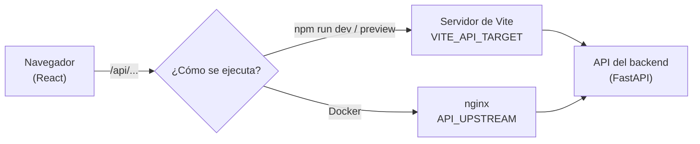
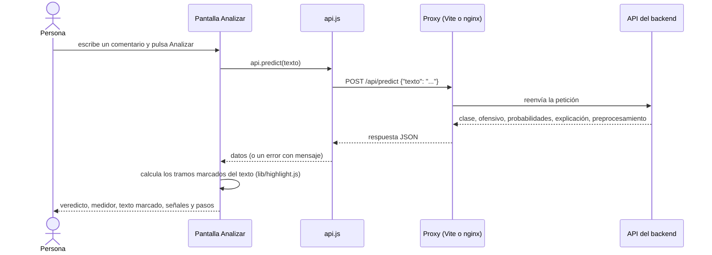

# Ofensómetro: documentación del frontend

Documentación técnica de la aplicación web del proyecto integrador de **Tópicos de Programación
Avanzada**. Describe qué hace la interfaz, cómo está construida, cómo se conecta con la API, por qué
se tomó cada decisión y cómo ejecutarla con y sin Docker.

> El funcionamiento del modelo, el preprocesamiento y la API están documentados en
> `documentacion-backend.md`. Este documento se centra en la interfaz.

## Contenido

1. [Resumen](#1-resumen)
2. [Arquitectura](#2-arquitectura)
3. [Pantallas](#3-pantallas)
4. [Código: módulos y componentes](#4-código-módulos-y-componentes)
5. [El texto marcado: cómo funciona](#5-el-texto-marcado-cómo-funciona)
6. [Contrato con la API](#6-contrato-con-la-api)
7. [Estados, errores y avisos](#7-estados-errores-y-avisos)
8. [Diseño visual y accesibilidad](#8-diseño-visual-y-accesibilidad)
9. [Pruebas automáticas](#9-pruebas-automáticas)
10. [Instalación y ejecución](#10-instalación-y-ejecución)
11. [Decisiones de diseño y limitaciones](#11-decisiones-de-diseño-y-limitaciones)
12. [Guía de defensa](#12-guía-de-defensa)

---

## 1. Resumen

### 1.1 Qué es

Una aplicación web de una sola página que permite **usar** el detector de lenguaje ofensivo e
**interpretar** sus resultados. Consume la API del backend por HTTP y no contiene ninguna lógica de
machine learning: todo el modelo y el preprocesamiento viven en el backend.

**Tecnología:** React 19 con Vite 8, en JavaScript. La única dependencia de ejecución, además de
React, son las fuentes tipográficas (empaquetadas dentro de la aplicación). No usa librerías de
componentes, de gráficos ni de enrutamiento.

### 1.2 Cumplimiento de la guía (sección 4.6)

| Requisito de la guía | Dónde se cumple |
|---|---|
| Interfaz web con framework libre que consuma la API | Todo el proyecto (React + Vite) |
| El usuario ingresa un texto **o sube un archivo con varios** | Pantallas **Analizar** y **Archivo** |
| Ver la **clase con su probabilidad** | Pantalla **Analizar**: veredicto, medidor y probabilidades de las cuatro clases |
| Vista del **preprocesamiento paso a paso**: texto normalizado, tokens, stop words eliminadas y lemas o raíces | Desplegable **Cómo se procesó el texto** en **Analizar** |
| **Panel con las métricas del modelo** y, si se usaron dos, su **comparación** | Pantalla **Modelo** (comparación de modelos, matrices de confusión, experimentos) |
| Contenedores como valor agregado (4.7) | `Dockerfile`, `docker-compose.yml` y `nginx.conf.template` |

Además, la interfaz aporta funciones que ayudan a **interpretar** el resultado:

- el comentario se muestra con las **palabras que más pesaron marcadas**;
- un **medidor** con el umbral de decisión;
- las **señales** detectadas (gritos, palabras disfrazadas, emojis, risas);
- el análisis exploratorio de los datos y el historial de predicciones.

### 1.3 Mapa de pantallas

| Pantalla | Ruta | Para qué sirve | Endpoint |
|---|---|---|---|
| Analizar | `#/analizar` | Clasificar un comentario y entender por qué | `POST /api/predict` |
| Archivo | `#/archivo` | Clasificar un `.txt` o `.csv` y descargar resultados | `POST /api/predict/batch` |
| Modelo | `#/modelo` | Métricas, comparación de modelos y análisis de errores | `GET /api/metrics` |
| Datos | `#/datos` | Análisis exploratorio del corpus | `GET /api/metrics` |
| Historial | `#/historial` | Predicciones y entrenamientos guardados | `GET /api/history`, `GET /api/trainings` |

En todas las pantallas se consultan además `GET /api/health` (aviso de modelo de demostración) y
`GET /api/labels` (nombres de las clases).

---

## 2. Arquitectura

### 2.1 Cómo se conecta con la API

El navegador **siempre llama a rutas relativas** (`/api/...`), nunca a la dirección real de la API.
Quién atiende esa ruta depende de cómo se ejecute:



Ventajas de este diseño:

- **No hace falta CORS**: el navegador solo habla con un origen.
- **El frontend es independiente del backend**: solo necesita saber *dónde* está la API, que se
  configura con una variable de entorno, sin tocar el código.
- La misma imagen de Docker sirve para cualquier entorno (la dirección de la API se lee al
  **arrancar** el contenedor, no al construirlo).

### 2.2 Recorrido de un análisis



### 2.3 Estructura del proyecto

```text
frontend/
├── package.json · package-lock.json · .nvmrc
├── vite.config.js            # proxy de /api en desarrollo y en preview
├── nginx.conf.template       # proxy de /api en Docker (usa API_UPSTREAM)
├── Dockerfile · docker-compose.yml · .env.example
└── src/
    ├── main.jsx              # punto de entrada; carga fuentes y estilos
    ├── App.jsx               # cabecera, avisos globales y navegación
    ├── api.js                # cliente de la API y manejo de errores
    ├── context.js            # contexto con las clases (nombre, descripción)
    ├── styles.css            # estilos y sistema de diseño
    ├── pages/                # Analyze · Batch · Model · Data · History
    ├── components/           # piezas reutilizables
    ├── lib/                  # funciones puras (highlight, csv, format, names)
    ├── hooks/useRequest.js   # carga de datos al abrir una pantalla
    └── test/                 # respuestas reales de la API usadas como datos de prueba
```

### 2.4 Estado de la aplicación

No se usa ninguna librería de estado global: la aplicación es pequeña y cada pantalla es dueña de
su estado.

| Dato | Dónde vive | Cómo se comparte |
|---|---|---|
| Página actual | La parte `#` de la URL (`#/modelo`) | Escuchando el evento `hashchange` |
| Clases (nombre, descripción, si ofenden) | `App.jsx`, cargadas una vez | **Contexto de React** (`context.js`): cualquier pantalla las lee con `useApp()` |
| Estado de salud del servicio | `App.jsx` | Solo para los avisos de la parte superior y el pie |
| Texto, resultado y errores de cada pantalla | El estado local de esa pantalla (`useState`) | No se comparte |
| Datos que se piden al abrir una pantalla | El hook `useRequest` | Cada pantalla pide lo suyo |

La navegación por `#` tiene una ventaja práctica: cada pantalla tiene su propia dirección, se puede
**compartir y recargar** sin perder el lugar, y no hace falta configurar el servidor para reescribir rutas.

---

## 3. Pantallas

### 3.1 Estructura general

Toda pantalla tiene una cabecera con el nombre y la navegación (con la página actual marcada),
una zona de **avisos globales**, el contenido y un pie con el modelo en uso.

**Avisos globales** (`App.jsx`):

| Situación | Aviso |
|---|---|
| La API no responde | Mensaje de error y botón **Reintentar** |
| El modelo no está entrenado (`modelo_cargado: false`) | Indica que hay que entrenarlo desde el backend |
| El modelo es de demostración (`modo_demo: true`) | «Modelo de demostración: se entrenó con datos sintéticos...» |

El pie muestra el modelo, su versión y el origen de los datos de entrenamiento.

### 3.2 Analizar

Es la pantalla principal. Está pensada alrededor de una idea: **el comentario es un documento en
revisión**. El usuario escribe en una hoja, y al analizar, esa misma hoja muestra el texto con las
palabras que pesaron marcadas, como con un marcador de editor.

**Flujo:**

1. La hoja se abre en modo **edición** (un cuadro de texto con letra serif, contador de 1000
   caracteres). El botón **Analizar** está desactivado mientras el texto esté vacío.
2. Al analizar (botón o **Ctrl + Enter**), la hoja pasa a modo **anotado**: el mismo texto, con las
   palabras influyentes marcadas. El botón **Editar texto** vuelve al modo edición.
3. Hay **cuatro ejemplos** de un clic para probar la herramienta.

**Lo que muestra el resultado:**

| Elemento | Qué muestra |
|---|---|
| **Veredicto** | «Ofensivo» o «No ofensivo» en grande, con la probabilidad y el umbral (por ejemplo, «a partir de 50 %») |
| **Medidor** | Una escala de 0 a 100 % con una marca en el umbral y otra en la probabilidad obtenida |
| **Clase más probable** | Nombre y descripción de la clase |
| **Aviso de discrepancia** | Si el veredicto y la clase más probable no coinciden, explica por qué (el veredicto suma las dos clases ofensivas) |
| **Barras por clase** | La probabilidad de cada una de las cuatro clases, con la predicha en negrita |
| **Palabras que empujaron hacia «ofensivo»** | Lista con una barra de peso relativo por cada palabra |
| **Señales detectadas** | Mayúsculas (gritos), palabras disfrazadas (`1di0ta` se leyó como `idiota`), emojis y risas |
| **Cómo se procesó el texto** | Desplegable con las etapas: texto normalizado, palabras, stop words eliminadas, raíces o lemas y lo que recibe el modelo |
| **Datos del modelo** | Nombre, versión y tiempo de respuesta |

Antes del primer análisis, el panel lateral explica cómo leer el resultado. En pantallas angostas,
el panel de resultado pasa a mostrarse arriba del texto.

> **Por qué «Palabras que empujaron hacia ofensivo» y no hacia la clase predicha:** el veredicto
> principal es binario, y quien lo lee quiere saber *qué palabras lo causaron*. La explicación hacia
> la clase predicha también llega en la respuesta de la API (`explicacion.clase`), pero no se
> muestra para no saturar la pantalla.

### 3.3 Archivo

Permite clasificar varios comentarios de una vez.

- Se elige o se **arrastra** un archivo `.txt` (un comentario por línea) o `.csv` (con una columna
  `texto`). Máximo 500 comentarios y 1 MB, en UTF-8.
- Muestra un **resumen** («X de Y comentarios son ofensivos», con el porcentaje) y la distribución
  por clase.
- Una **tabla de resultados** con la fila, el comentario, el veredicto, la probabilidad y la clase.
  Se muestran de 50 en 50 con el botón **Mostrar más**.
- **Filtros**: todos, ofensivos, no ofensivos.
- Si hay filas inválidas, un desplegable las lista con su número y el motivo.
- Botón **Descargar resultados (CSV)**: se genera en el navegador, con codificación UTF-8 con BOM
  para que Excel lea bien las tildes y con las comillas y comas escapadas.

### 3.4 Modelo

Responde a la parte de la guía sobre métricas y comparación de modelos. Con los datos de
`GET /api/metrics` muestra:

| Sección | Contenido |
|---|---|
| Resumen | El modelo en producción, cuándo se entrenó, con cuántos comentarios y el tamaño del vocabulario |
| **Comparación de modelos** | Tabla con F1 macro en validación y en prueba, exactitud y F1 de la clase ofensiva, de cada modelo y de la línea base; el de producción queda marcado |
| **Dónde acierta y se equivoca** | Dos **matrices de confusión** (4 clases y vista binaria). El color de cada celda indica qué parte de su fila cae ahí |
| Métricas por clase | Precisión, recall, F1 y cantidad de comentarios de prueba |
| **Qué decisiones importaron** | El mejor resultado con cada opción (raíz o lema, lista de stop words, palabras sueltas o pares, modelo) |
| **Configuraciones probadas** | Las 12 mejores de todas las evaluadas con validación cruzada |
| **Cuándo falla más** | Exactitud según cómo está escrito el comentario (mayúsculas, ofuscación, emojis...) y según la plataforma |
| Términos que más empujan hacia cada clase | **Tras un aviso** (contiene lenguaje ofensivo real) |
| Errores con más seguridad | **Tras un aviso** (ejemplos reales de errores del modelo) |

### 3.5 Datos

El análisis exploratorio del corpus, también desde `GET /api/metrics`:

- cuántos comentarios hay de cada clase y cuántos quedaron en entrenamiento y en prueba;
- la **razón de desbalance** y por qué obliga a usar F1 macro y no solo exactitud;
- qué se limpió (vacíos, etiquetas desconocidas, duplicados, textos con etiquetas conflictivas);
- la distribución de las longitudes de los comentarios;
- los comentarios por plataforma y clase;
- las palabras más frecuentes de cada clase, **tras un aviso**.

### 3.6 Historial

Muestra lo que guardó la base de datos del backend: las **últimas 30 predicciones** (con fecha,
comentario, veredicto, probabilidad, clase y origen: individual o archivo) y los
**entrenamientos** registrados (versión, fecha, modelo, origen de los datos y métricas). Si la API
no tiene base de datos configurada, explica el motivo y permite reintentar. La pantalla avisa de
que las predicciones incluyen los textos enviados por quienes usan la aplicación.

### 3.7 Contenido ofensivo tras un aviso

Las secciones que reproducen lenguaje ofensivo real (palabras frecuentes, términos por clase,
ejemplos de errores) **no se muestran** hasta que la persona pulsa **Mostrar contenido ofensivo**, y
pueden volver a ocultarse. Es una decisión de cuidado hacia quien usa la aplicación.

---

## 4. Código: módulos y componentes

### 4.1 Núcleo

| Archivo | Responsabilidad |
|---|---|
| `main.jsx` | Carga las fuentes y los estilos y monta la aplicación |
| `App.jsx` | Cabecera, navegación por `#`, avisos globales, carga de las clases y la salud del servicio, pie |
| `api.js` | Cliente de la API (`fetch`), la clase `ApiProblem` y la traducción de errores |
| `context.js` | Contexto con las clases y el hook `useApp()`, que además arma un diccionario por código |
| `hooks/useRequest.js` | Pide datos al abrir una pantalla; descarta respuestas viejas si ya se pidió otra |

**`useRequest`** guarda un «ticket» por petición. Si la pantalla se cierra o se vuelve a pedir antes
de que llegue una respuesta, esa respuesta vieja se ignora; así nunca se pinta un dato desactualizado.

### 4.2 Funciones puras (`lib/`)

Son funciones sin dependencia de React ni del navegador, por lo que se prueban de forma aislada.

| Archivo | Función |
|---|---|
| `highlight.js` | `segment(texto, términos, ofuscadas)`: parte el texto en tramos y decide cuáles marcar (ver sección 5) |
| `csv.js` | `toCsv(filas, columnas)`: genera el CSV con comillas escapadas y BOM; `downloadText` lo descarga |
| `format.js` | Formato en español: porcentajes con coma decimal, enteros, fechas, texto recortado |
| `names.js` | Nombres legibles para los identificadores del modelo (`stem` → «Raíz (stemming)») |

### 4.3 Componentes (`components/`)

| Componente | Qué dibuja |
|---|---|
| `Annotated` | El comentario con las palabras influyentes marcadas (`<mark>`) |
| `Meter` | La escala de probabilidad con el umbral y el valor |
| `ClassBars` | Una barra por clase (colores según sea o no ofensiva) |
| `Bars` | Barras horizontales genéricas, usadas en las pantallas de datos y modelo |
| `ConfusionMatrix` | Tabla de confusión con celdas coloreadas por la proporción de su fila |
| `Signals` | Las señales detectadas, como etiquetas |
| `Steps` | El desplegable con las etapas del preprocesamiento |
| `ContentGate` | La puerta que oculta el contenido ofensivo hasta que se pida |
| `State` | Los estados comunes: «Cargando...» y el error con botón **Reintentar** |

### 4.4 Cliente de la API (`api.js`)

Todas las llamadas pasan por una única función `request`, que:

1. hace la petición a la ruta relativa (`/api/...`);
2. si **no hay conexión**, lanza un `ApiProblem` con un mensaje claro («No se pudo conectar con el
   servidor. Comprueba que la API esté en marcha.»);
3. si la API responde con error, usa el mensaje `error` que vino en el JSON (el backend ya lo
   escribe en español), por lo que **la interfaz muestra el mensaje tal cual**;
4. si el servidor corta la petición sin devolver JSON (por ejemplo, nginx rechaza un archivo de más
   de 2 MB con un 413), traduce el código a un mensaje comprensible.

Las pantallas nunca construyen mensajes de error propios: reciben un `ApiProblem` y lo muestran.

---

## 5. El texto marcado: cómo funciona

Es la parte más delicada de la interfaz y merece explicación propia.

### 5.1 El problema

La API devuelve las palabras influyentes **ya normalizadas por el modelo**, no como las escribió la
persona. Por ejemplo, para el comentario `Qué 1di0ta, eres` la API dice que pesó la palabra
`idiota`, pero en el texto original aparece `1di0ta,`. Para marcar la palabra correcta en la hoja
hay que **volver a emparejar** lo que el modelo vio con lo que el usuario escribió.

### 5.2 El algoritmo (`lib/highlight.js`)

Recorre el texto original palabra por palabra y, para cada una, prueba varias formas de
emparejarla con las palabras de la API:

| Caso | Cómo se resuelve |
|---|---|
| Mayúsculas y tildes (`IDIÓTA`) | Se comparan sin tildes y en minúsculas |
| **Palabras disfrazadas** (`1di0ta,`) | La API informa en `senales.ofuscadas` cómo restauró cada una (`1di0ta,` → `idiota,`); se usa ese emparejamiento, limpiando la puntuación pegada |
| **Alargamientos** (`idiotaaaa`) | Se prueba también la palabra con las letras repetidas reducidas |
| **Censura con asteriscos** (`p*ta`) | Se prueba también la palabra sin asteriscos |
| **Pares de palabras** (`eres idiota`, un bigrama) | Se marca cada palabra del par |
| **Señales** (`(mayúsculas)`, `(emoji ofensivo)`) | No se marcan en el texto: no son palabras, se muestran como etiquetas |

El resultado es una lista de tramos `{texto, nivel}`, donde `nivel` es `null` en el texto normal y
un valor entre 0 y 1 en las palabras marcadas (1 = la palabra que más pesó). El texto se
reconstruye **sin perder ni cambiar** ningún carácter (espacios, saltos de línea y emojis incluidos).

### 5.3 La intensidad

El `nivel` controla qué tan fuerte es el marcador: una variable CSS (`--level`) mezcla el color con
más o menos intensidad, de modo que **la palabra que más pesó se ve más marcada que las demás**. Al
mostrar el resultado, los marcadores aparecen con una única animación de barrido, palabra por
palabra, que se desactiva si el sistema pide reducir el movimiento.

---

## 6. Contrato con la API

Campos que usa la interfaz, tal como los devuelve el backend:

| Endpoint | Campos usados |
|---|---|
| `POST /api/predict` | `ofensivo`, `probabilidad_ofensivo`, `umbral`, `clase`, `nombre_clase`, `descripcion`, `probabilidades`, `explicacion.ofensivo[].{palabra, peso}`, `preprocesamiento` (con `senales`), `modelo`, `tiempo_ms` |
| `POST /api/predict/batch` | `total`, `ofensivos`, `resumen`, `resultados[]`, `omitidas[]` |
| `GET /api/health` | `modelo_cargado`, `modo_demo`, `modelo`, `version`, `datos` |
| `GET /api/labels` | `codigo`, `nombre`, `descripcion`, `ofensivo` |
| `GET /api/metrics` | `production`, `models`, `experiments`, `factor_effects`, `dataset`, `accuracy_by_phenomenon`, `accuracy_by_platform`, `top_terms`, `error_examples`, `threshold`, `split`, `vocabulary_size`, `trained_at` |
| `GET /api/history`, `GET /api/trainings` | Las filas guardadas en la base |
| Errores | `{"error": "mensaje"}`; se muestra tal cual |

Las pruebas del frontend usan **respuestas reales de la API** guardadas en `src/test/*.json`
(generadas con el backend), por lo que verifican el contrato real y no uno inventado. Si el backend
cambia sus respuestas, esas copias deben actualizarse y las pruebas avisarán si el contrato se rompió.

Una constante del frontend debe coincidir con el backend: el máximo de 1000 caracteres del cuadro de
texto (`MAX_CHARS` en `pages/Analyze.jsx`) refleja `data.max_chars` de `params.yaml`. Si se cambia
allí, hay que cambiarlo también aquí; la API siempre valida de todas formas.

---

## 7. Estados, errores y avisos

La interfaz cubre cada situación en que algo puede salir distinto de lo esperado:

| Situación | Comportamiento |
|---|---|
| Se están cargando datos | Mensaje «Cargando...» accesible para lectores de pantalla |
| La API no responde | Mensaje claro y botón **Reintentar** |
| La API aún está arrancando | Igual que el anterior: tarda unos segundos en cargar el modelo; al reintentar funciona |
| La API rechaza una entrada | Muestra el mensaje de la API (por ejemplo «El texto no contiene palabras.») y **deja el texto editable** para corregirlo |
| El archivo no sirve | Muestra el motivo (formato, columna `texto`, codificación, tamaño, sin comentarios válidos) |
| Archivo mayor al permitido por nginx | Traduce el 413 a «El archivo es demasiado grande. El máximo es 1 MB.» |
| Algunas filas de un archivo son inválidas | El resto se procesa; las omitidas se listan con su motivo |
| Sin base de datos (Historial) | Explica que el historial necesita la base configurada |
| Modelo sin entrenar | Aviso global con la instrucción para entrenarlo |
| **Modelo de demostración** | Aviso global en todas las pantallas |
| Contenido ofensivo real | Oculto tras un aviso |
| No hay resultados con un filtro | «Ningún comentario coincide con este filtro.» |

---

## 8. Diseño visual y accesibilidad

### 8.1 Idea de diseño

La interfaz se concibe como una **hoja de revisión**: el comentario es el documento y el resto es
margen. Por eso lo único con carácter fuerte es el texto marcado; todo lo demás es sobrio.

| Elemento | Decisión |
|---|---|
| **Color** | Fondo de un gris frío, tinta azul-negra, **rojo marcador** para lo ofensivo, **verde-azulado** para lo que no lo es y **índigo** para la interfaz |
| **Tipografía** | IBM Plex Sans para la interfaz y Source Serif 4 para el texto que se analiza y los títulos: el comentario se ve como un documento |
| **Fuentes empaquetadas** | Viajan dentro de la aplicación: no se piden a internet, así que funciona sin conexión externa |
| **Modo oscuro** | Sigue la preferencia del sistema, con una paleta propia |
| **Pantallas angostas** | El diseño se reorganiza: el resultado pasa arriba, las columnas se apilan |
| **Movimiento** | Una sola animación (el barrido del marcador), desactivada con *reducir movimiento* |

Los estilos usan **variables CSS** para toda la paleta, lo que hace trivial cambiar un color o el
modo oscuro desde un único lugar (`styles.css`).

### 8.2 Accesibilidad

| Medida | Dónde |
|---|---|
| **El color nunca es la única señal**: el veredicto, las insignias y las barras siempre llevan texto («Ofensivo», «No ofensivo») | Toda la interfaz |
| Navegación por teclado con **foco visible** | Todos los controles |
| `role="meter"` con `aria-valuenow` y `aria-valuetext` | El medidor de probabilidad |
| `aria-live="polite"` en el panel de resultado | Se anuncia el resultado al terminar |
| `aria-current="page"` en la navegación | La página actual |
| Tablas con título (`<caption>`, oculto visualmente) y encabezados con `scope` | Todas las tablas |
| Etiquetas asociadas a los campos | Cuadro de texto, selector de archivo |
| `aria-pressed` en los filtros | Pantalla **Archivo** |
| `role="alert"` y `role="status"` en errores y avisos | Estados |
| Idioma declarado (`lang="es"`) | Documento y texto analizado |
| Respeto de `prefers-reduced-motion` y `prefers-color-scheme` | Estilos |

**Compatibilidad:** los estilos usan `color-mix()` y `:focus-visible`, disponibles en los
navegadores modernos (de 2023 en adelante). No se garantiza el funcionamiento en navegadores más
antiguos.

---

## 9. Pruebas automáticas

```bash
npm test      # 27 pruebas
```

Se usan **Vitest** y **Testing Library** con un entorno de navegador simulado (jsdom). Las pruebas
no necesitan la API: simulan `fetch` con las respuestas reales guardadas.

| Archivo | Pruebas | Qué cubre |
|---|---|---|
| `src/lib/lib.test.js` | 12 | **Texto marcado** (marca las palabras sin alterar el texto, intensidad, tildes y mayúsculas, palabras disfrazadas con puntuación pegada, alargamientos, censura, pares de palabras, señales, emojis y saltos de línea); generación del CSV (comillas, comas, saltos de línea, BOM); formato de porcentajes |
| `src/App.test.jsx` | 15 | La aplicación completa, descrita abajo |

Detalle de `App.test.jsx`:

| Grupo | Qué verifica |
|---|---|
| Estructura (2) | Aviso de modelo de demostración y página marcada en la navegación; mensaje y botón **Reintentar** si la API no responde |
| Analizar (5) | Veredicto, marcado de la palabra disfrazada, señales y clase; comentario amable como «No ofensivo»; el texto se envía recortado; el mensaje de error de la API se muestra y el texto sigue editable; un ejemplo se analiza con un clic |
| Archivo (3) | Resumen, filtros y descarga; filas omitidas; motivo si el archivo no sirve; traducción del 413 de nginx |
| Modelo y Datos (3) | Comparación con el modelo en producción marcado y matrices de confusión; el contenido ofensivo se oculta y se muestra al pedirlo; pantalla de Datos |
| Historial (2) | Sin base de datos explica el motivo; lista las predicciones guardadas |

**Qué no cubren:** no hay pruebas automáticas de extremo a extremo en un navegador real, ni de
aspecto visual. El aspecto se verificó manualmente.

---

## 10. Instalación y ejecución

### 10.1 Requisitos

- **Node.js 22.22 o superior** (hay un `.nvmrc`) y npm. Las herramientas de pruebas (`vitest`,
  `jsdom`) exigen esa versión.
- Una **API del backend en marcha** para usar la aplicación (no hace falta para las pruebas ni
  para compilar).
- Docker es opcional.

### 10.2 Configuración

| Variable | Se usa en | Por defecto | Para qué |
|---|---|---|---|
| `VITE_API_TARGET` | `npm run dev`, `npm run preview` | `http://127.0.0.1:8000` | Dónde está la API |
| `API_UPSTREAM` | Docker (nginx) | `http://host.docker.internal:8000` | Dónde está la API, vista desde el contenedor. **Sin barra final** |
| `WEB_PORT` | Docker Compose | `8080` | Puerto donde se publica la web |

Se pueden definir en el entorno o en un archivo `.env` (copiar `.env.example`); la variable del
entorno gana sobre el `.env`.

### 10.3 Sin Docker

```bash
npm install
npm run dev          # http://localhost:5173, recarga al guardar
```

La API debe estar en `http://127.0.0.1:8000`; si está en otro lugar:
`VITE_API_TARGET=http://otro-host:8000 npm run dev`.

Para comprobar el build de producción:

```bash
npm run build        # genera dist/
npm run preview      # http://localhost:4173
```

`npm run preview` sirve para revisar el build, no para producción. Para publicar sin Docker hay que
servir `dist/` con un servidor web que **reenvíe `/api` a la API** (la configuración de
`nginx.conf.template` es un ejemplo).

### 10.4 Con Docker

Solo el frontend:

```bash
docker compose up --build        # http://localhost:8080
```

Busca la API en el equipo anfitrión (puerto 8000). Para otra dirección:
`API_UPSTREAM=http://192.168.1.20:8000 docker compose up --build`.

Sin Compose:

```bash
docker build -t ofensometro-web .
docker run --rm -p 8080:80 -e API_UPSTREAM=http://host.docker.internal:8000 ofensometro-web
```

**Qué hace la imagen:** una primera etapa con Node compila la aplicación (`npm ci` y
`npm run build`); la imagen final contiene solo nginx con los archivos compilados, sin Node. nginx:

- sirve la aplicación;
- reenvía `/api/` a `API_UPSTREAM` (la plantilla `nginx.conf.template` se completa al arrancar el
  contenedor con esa variable);
- permite cuerpos de hasta 2 MB (la API acepta 1 MB);
- comprime los textos (`gzip`);
- guarda en caché por un año los archivos de `/assets/` (llevan el hash de su contenido en el
  nombre) y **nunca** guarda `index.html`, para que una versión nueva se vea al recargar.

### 10.5 Junto con el backend en un mismo compose

```yaml
  web:
    build: ./frontend
    environment:
      API_UPSTREAM: http://api:8000      # nombre del servicio de la API, sin barra final
    ports:
      - "8080:80"
    depends_on:
      api:
        condition: service_healthy       # nginx necesita que el nombre `api` exista al arrancar
```

### 10.6 Problemas habituales

| Situación | Qué hacer |
|---|---|
| «No se pudo conectar con el servidor» | La API no está en marcha o todavía arranca (tarda unos segundos): esperar y pulsar **Reintentar** |
| `npm run dev` abre, pero `/api` falla | Revisar `VITE_API_TARGET` y que la API responda en esa dirección |
| El puerto 5173 está ocupado | Vite usa el siguiente (5174...) y lo muestra en la terminal |
| `npm install` advierte `EBADENGINE` | Node anterior a 22.22: actualizarlo (`nvm use` lee `.nvmrc`) |
| Docker: `host not found in upstream` | El nombre de `API_UPSTREAM` no existe en esa red: revisar el nombre del servicio o usar `host.docker.internal` |
| Docker: todo da 404 en `/api` | `API_UPSTREAM` termina en `/`: quitar la barra final |
| Docker: todo da 502 | La API no está en marcha o no es alcanzable desde el contenedor |
| Un archivo grande da error 413 | Es lo esperado: nginx corta lo que supera 2 MB y la API acepta hasta 1 MB |

---

## 11. Decisiones de diseño y limitaciones

### 11.1 Decisiones principales

| Decisión | Alternativa descartada | Por qué |
|---|---|---|
| **React + Vite en JavaScript** | Vue, Angular, TypeScript | Mucha documentación, rápido de levantar y menos que explicar; JavaScript evita sumar tipos y configuración a un frontend que es secundario |
| **Sin librerías de componentes ni de gráficos** | Material UI, Chart.js | Menos dependencias que mantener y explicar; las barras y la matriz de confusión se resuelven con HTML y CSS |
| **Navegación por `#`** | React Router | Son cinco pantallas; evita una dependencia y no requiere configurar el servidor |
| **Proxy (Vite o nginx) para `/api`** | Llamar a la API directamente | Un solo origen: no hace falta CORS y el frontend no conoce la dirección de la API |
| **Dirección de la API como variable de entorno** | Escribirla en el código | El frontend es independiente del backend y la misma imagen sirve para cualquier entorno |
| **Calcular el texto marcado en el navegador** | Que la API devuelva las posiciones | La API explica al *modelo*; emparejar con lo que escribió la persona es un asunto de presentación |
| **Veredicto binario primero, clase como detalle** | Mostrar solo la clase | Es lo que quien modera necesita; el detalle sigue a la vista |
| **Ocultar el contenido ofensivo real** | Mostrarlo siempre | Cuidado con quien usa la aplicación |
| **Aviso permanente de modelo de demostración** | No avisar | Evita confundir resultados de prueba con reales |
| **Fuentes empaquetadas** | Cargarlas desde un servicio externo | Funciona sin conexión externa y sin rastreo de terceros |
| **Pruebas con respuestas reales de la API** | Datos inventados | Verifican el contrato real entre ambos proyectos |

### 11.2 Limitaciones

- **Sin autenticación**: cualquiera con acceso a la dirección puede usar la aplicación y ver el
  historial. Es un proyecto académico.
- **Privacidad**: la pantalla **Historial** muestra los textos que enviaron otras personas.
  En un despliegue real habría que restringirla o anonimizarla.
- **Solo la versión web**: no hay aplicación móvil (se acordó no implementarla). La interfaz es
  adaptable a pantallas pequeñas, pero no es una app nativa.
- **El historial no pagina**: muestra las últimas 30 predicciones.
- **El máximo de caracteres está duplicado** entre el frontend y `params.yaml` (la API siempre valida).
- **Sin pruebas en navegador real**: las pruebas usan un navegador simulado; el aspecto visual y la
  animación se verificaron a mano.
- **Compatibilidad**: pensada para navegadores modernos (sección 8.2).
- **El resaltado depende de la explicación del modelo** (aproximada, ver la documentación del
  backend): marca lo que empujó al modelo, no una prueba de que la palabra sea ofensiva.
- **Un solo idioma**: la interfaz está en español y los textos están escritos dentro del código.

---

## 12. Guía de defensa

**¿Por qué React con Vite y JavaScript?**
React tiene mucha documentación y Vite levanta rápido y compila a archivos estáticos que sirve
nginx. Elegí JavaScript y no TypeScript para no sumar tipos y configuración en la parte secundaria
del proyecto; el foco está en el modelo y el pipeline.

**¿Por qué no usaron una librería de componentes o de gráficos?**
Para reducir dependencias y poder explicar todo el código. Las barras y la matriz de confusión son
HTML y CSS; con una librería tendría más código que no es mío que explicar.

**¿Cómo se comunica el frontend con el backend?**
Con `fetch` a rutas relativas `/api/...`. En desarrollo las reenvía el servidor de Vite y en Docker
las reenvía nginx. Así el navegador ve un solo origen y no hace falta CORS. La dirección de la API se
configura con una variable de entorno, no con código. (Sección 2.1.)

**¿Dónde está la lógica del modelo en el frontend?**
No hay ninguna. Todo el preprocesamiento y el modelo viven en el backend; el frontend solo envía el
texto y dibuja la respuesta. Por eso no puede haber diferencias entre lo entrenado y lo servido.

**¿Cómo cumple con mostrar el preprocesamiento paso a paso?**
En **Analizar**, el desplegable **Cómo se procesó el texto** muestra el texto normalizado, las
palabras, las stop words eliminadas, las raíces o lemas y lo que finalmente recibe el modelo. Esos
datos llegan en el campo `preprocesamiento` de la respuesta de la API. (Sección 3.2.)

**¿Cómo marcan las palabras que pesaron dentro del texto del usuario?**
La API devuelve las palabras ya normalizadas, y el frontend las vuelve a emparejar con lo que
escribió la persona: sin tildes ni mayúsculas, deshaciendo las palabras disfrazadas con la
información que da la API, y tolerando alargamientos y censura con asteriscos. La intensidad del
marcador depende del peso de cada palabra. (Sección 5.)

**¿Por qué el veredicto y la clase pueden no coincidir, y cómo lo muestra la interfaz?**
El veredicto suma `P(OFP) + P(OFG)`. Si la suma supera el umbral pero `NO` es la clase individual
más probable, la interfaz lo dice explícitamente en un aviso, en lugar de dejar al usuario
confundido.

**¿Cómo manejan los errores?**
Toda llamada pasa por una sola función que traduce los problemas a mensajes claros: sin conexión,
errores de la API (cuyo mensaje, ya en español, se muestra tal cual), archivos demasiado grandes. El
texto del usuario no se borra al fallar, para poder corregirlo. (Secciones 4.4 y 7.)

**¿Por qué el contenido ofensivo está oculto en algunas pantallas?**
Porque las palabras frecuentes y los ejemplos de errores reproducen lenguaje ofensivo real, y mostrarlo
sin aviso no es respetuoso con quien usa la aplicación. Se muestra solo si la persona lo pide.

**¿Cómo se prueba el frontend?**
Con 27 pruebas automáticas (Vitest y Testing Library) que simulan `fetch` con respuestas reales de la
API: cubren la lógica del texto marcado y del CSV y las pantallas completas, incluidos los errores.
No hay pruebas en un navegador real; el aspecto se verificó a mano. (Sección 9.)

**¿Qué haría con más tiempo?**
Pruebas de extremo a extremo en un navegador real, autenticación y anonimización del historial,
paginación del historial en el servidor, una app móvil, y permitir al usuario ajustar el umbral de
decisión viendo cómo cambia el veredicto.
